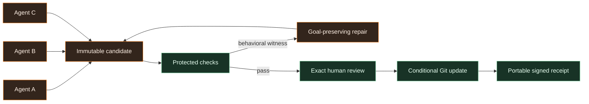
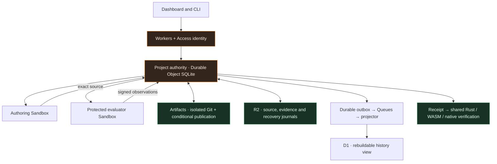

#  Confidence

**Parallel agents. One release you can independently verify.**

Confidence connects concurrent coding agents to an inspectable release decision: exact source, behavioral evidence, human consent, conditional Git publication, and a portable signed receipt.

**Primary contributors:** [Laurence Avent (@postrv)](https://github.com/postrv) and [Quentin Cody (@quentincody)](https://github.com/quentincody).

[Try it locally](#try-it-locally) · [Design choices](#design-choices-that-matter) · [Performance](#performance-with-context) · [Judge packet](docs/judge-packet/README.md)


## From parallel work to a release you can explain

Three agents improve a cache. Their edits combine cleanly, yet a warm read returns an old value after an acknowledged write. The interesting work starts here: expose the interaction, repair freshness while keeping the cache useful and the saved-value status accessible, then show exactly why the repaired source may ship.

Confidence keeps that whole explanation together. The retained Cloudflare pilot completed concurrent real-model work, a behavioral failure, goal-preserving repair, nine protected cases, exact human review, Artifacts publication and independent receipt verification. [Follow the recorded journey](docs/PILOT_RELEASE_GATE_F508454.md).

## Design choices that matter

| Choice | Why it matters |
| --- | --- |
| **Compose immutable contributions.** | Attempts retain their bases and lineage. A candidate names exact combined source, so an interaction witness can be traced back to the work that produced it. |
| **Repair the useful goal.** | Bounded counterexamples and source-bound repair context guide the next attempt. Freshness, retained caching and accessible status stay in the declared goal; protected evaluation checks the repaired behavior. |
| **Approve exact source once.** | Human consent binds the candidate, evidence, goal, policy and expected head. Publication consumes that approval and conditionally updates fixed old/new Git heads. |
| **Keep uncertainty durable.** | A lost response stays unresolved. Recovery reconciles the original operation and its exact bytes; command identities, journals and held capacity survive retries. |
| **Make proof portable.** | A shared pure Rust rulebook runs through browser/WASM and a native verifier. Receipts bind source, authorization and observed publication; the verifier uses separately selected trust. |
| **Let tools advise; keep authority explicit.** | Narsil supplies verified source context; Interlinked previews complete changesets. Authoring and protected evaluation use separate execution environments, and diagnostics cannot approve a release. |

The distinctive contribution is this connected explanation and authority model. Ordinary CI with the same effective checks can catch the cache bug too. [Evidence and claim boundaries](docs/judge-packet/CLAIMS.md).

## How a release becomes verifiable



The browser can verify the complete supported Git object closure before approval. After publication, the receipt can be checked outside the running service. Verification establishes the recorded identities, authorization and observations within the selected trust model. [Architecture tour](docs/ARCHITECTURE_TOUR.md) · [Offline verification](docs/judge-packet/RUN.md).

## Performance, with context

Two evaluator slots overlap independent checks. Batched Git plumbing cuts process startup overhead. Immutable inputs make those optimizations inspectable. The measurements below retain their actual workloads and denominators.

| Measured capability | Observed result | Scope |
| --- | --- | --- |
| **Overlapped protected evaluation** | Median **2,227.337 → 1,261.306 ms**, **43.37% lower elapsed** | Five passing pairs of the same local eight-job plan; 14 plans / 112 jobs including negative cases. Today's recipe has nine jobs. |
| **Batched source preparation** | **6,006 → 8 Git processes**; **74,456.8 → 332.9 ms**, identical commit | One local 1,000-file pair, 1 KiB per file. A single component sample. |
| **Native coding with both team tools** | **258.371 → 120.612 s**; **2 → 1 model calls**; both outputs passed **9/9** | One designed task, one episode per mode; Narsil and Interlinked changed together. |
| **Complete recorded comparison workflow** | Tools disabled **631.147 s**; enabled **1,106.485 s** | Includes deployment, operator pause, separate reconciliation and cleanup. The enabled original controller remained `INCOMPLETE`. |
| **Separate automatic completion** | **205.530 s** from coding dispatch through verified cleanup, **1 call**, **9 verified checker signatures** | One new tools-enabled episode, deployment excluded; separate from the paired comparison. |

These dated observations establish narrower capabilities, not a general coding speedup or sustained useful-release throughput. The full-workflow result and original failure remain visible. [Benchmarks and original data](docs/BENCHMARKS.md) · [Throughput definitions](docs/THROUGHPUT.md) · [Separate confirmation](docs/TOOLS_RECOVERY_CONFIRMATION_2026-10-12.md).

## Built on Cloudflare, with deliberate trust boundaries



Project-scoped authority owns decisions; D1 is a derived view. Artifacts owns the canonical Git ref, R2 retains its supporting bytes, and separate Sandboxes author and check. The verifier can run independently of the service. [Read the implementation map](docs/ARCHITECTURE_TOUR.md).

## Try it locally

Use macOS or Linux, Git, Node **24** (minimum **22.19**), Rust **1.98.0** and wasm-pack **0.13.1**:

```sh
git clone https://github.com/postrv/confidence-release.git
cd confidence-release
rustup show
cargo install wasm-pack --version 0.13.1 --locked
npm ci
npm run build
npm run demo
npm run verify -- demo-output/receipt.json demo-output/trust.json demo-output/checkpoint-attestation.json
```

The bundled local journey needs no Cloudflare account, private Weft source or paid model call. It uses predetermined edits, concurrent local subprocesses, real Git, HTTP checks from a separate local process, synthetic approval and explicitly selected local trust. Run only the trusted fixture: local processes share your host identity.

For the interactive dashboard, run `npm run dev` and open the printed loopback URL. For the full local source gate, run `npm run test:local`; Docker image checks and the standalone Pi smoke check have separate instructions. [Complete setup, fresh sessions and tamper-negative verification](docs/judge-packet/RUN.md).

## Team tools and supported scope

**Narsil 1.7.2**, created by **Laurence Avent**, provides bounded, source-verified context from an immutable checkout. **Interlinked CLI 0.1.0**, created by **Quentin Cody**, previews proposed changesets before writes. Their advice improves the authoring loop while protected acceptance and publication remain explicit authority decisions. [Integration details, pins and licenses](docs/TEAM_TOOLS.md).

The native closed pilot currently supports a bounded JavaScript cache workload. Project discovery, committed Git import, source review, discussion and scoped contributor/reviewer roles are separate capabilities. Full-repository protected execution remains unregistered. **Weft is an optional private dependency**; the complete ordinary local workflow runs without it. The public distribution includes Confidence's adapters and synthetic fixtures, and excludes private Weft implementation and credentials. [Integration boundary](docs/WEFT_INTEGRATION.md) · [Collaboration permissions](docs/COLLABORATION_PERMISSIONS.md).

## Explore further

| Start here | What you will find |
| --- | --- |
| [Judge packet](docs/judge-packet/README.md) | A short route through the demo, evidence and independent verification. |
| [Evidence map](docs/EVIDENCE.md) | Native observations, local reproduction and mocks with their own source identities. |
| [Technical design](docs/DESIGN.md) · [Publication model](model/README.md) | Invariants, recovery semantics and design rationale. |
| [Operations](docs/PILOT_OPERATIONS.md) | Bounded monitoring, operating limits and unresolved qualification gaps. |
| [Benchmarks](docs/BENCHMARKS.md) | Measured intervals, controls, failures and reproducible component experiments. |

This is the reviewed source distribution for [postrv/confidence-release](https://github.com/postrv/confidence-release). Its [source manifest](PUBLIC_SOURCE_MANIFEST.json) records original source, output digests, disclosed transformations and excluded private material. The clean public Git history differs from private development history. Historical reports retain their original scope; publication of source is separate from competition entry.

Original Confidence source is [Apache-2.0](LICENSE), with [NOTICE](NOTICE). Third-party tools and packages retain their licenses. The banner is conceptual artwork; its [asset provenance](docs/assets/README.md) is separate from recorded product screenshots and measurements.
