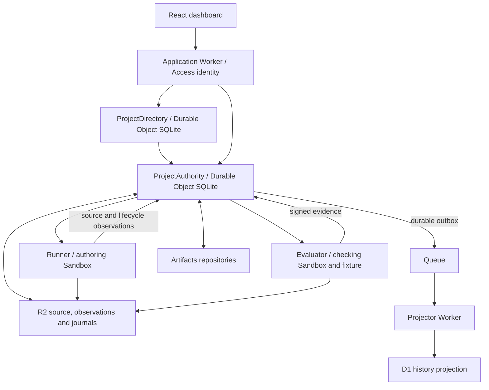

# Architecture tour

Confidence lets concurrent attempts contribute to one change, checks how their work behaves together, and records why an exact commit was approved and published. Its central distinction is simple: an attempt can propose work; the project authority decides whether that work may become the accepted release.

This is a map of the current implementation. [Release status](RELEASE_STATUS.md)
names the deployed source and supported boundaries; the [evidence guide](EVIDENCE.md)
connects demonstrated results to their exact records. Use the [current handoff](TEAM_HANDOFF.md)
and [public-source preparation](PUBLIC_SUBMISSION_HANDOVER.md) for submission
work. Archived implementation (retained private reference; unavailable in this source distribution) and
production planning (retained private reference; unavailable in this source distribution) preserve earlier
rationale and dated gaps, not the current checklist. The larger [design](DESIGN.md)
also contains intended capabilities beyond the shipped pilot.

The optional [Weft integration](WEFT_INTEGRATION.md) adds live shared-worktree
collaboration through an authenticated service boundary. Its durable handoff
acquires one exact retained revision and uses the existing source materializer,
evaluation, review and publication machinery. This development branch is not a
deployed pilot release; its verification status is recorded in that guide.

## The Cloudflare shape

These are existing bindings, not a list of services every feature must use.

| Boundary | What it owns | Start reading here |
| --- | --- | --- |
| Application | Static assets, verified identity, scoped API forwarding and display adaptation. It has no repository, R2 or signing binding. | [app/index.ts](../workers/app/index.ts), [shared/auth.ts](../workers/shared/auth.ts), [app/adapter.ts](../workers/app/adapter.ts) |
| Project directory | Project discovery and exact creation intents; each project rechecks membership before disclosure. | [project-directory.ts](../workers/authority/project-directory.ts), [project-catalog.ts](../workers/authority/project-catalog.ts) |
| Project authority | Membership, grants, command deduplication, immutable records, approvals, publication state and recovery outbox in project-scoped SQLite. | [authority/index.ts](../workers/authority/index.ts), [schema.ts](../workers/authority/schema.ts), [types.ts](../workers/authority/types.ts) |
| Repository adapter | Separate attempt repositories, exact source ingestion/materialization and a conditional canonical update naming both old and new commits. | [authority/artifacts.ts](../workers/authority/artifacts.ts) |
| Runner | One authoring generation, source hydration, model/Git brokering, context capture and observed shutdown. Provider credentials stay in the broker. | [runner/index.ts](../workers/runner/index.ts), [runner/context.ts](../workers/runner/context.ts) |
| Evaluator | Durable scheduling, separate evaluation generations, fixture state, external HTTP checks and signed observations. | [evaluator/index.ts](../workers/evaluator/index.ts), [recipes.ts](../workers/evaluator/recipes.ts), [hydration.ts](../workers/evaluator/hydration.ts) |
| Object store | Digest-addressed source/evidence and immutable recovery journals, verified by readback. | [shared/objects.ts](../workers/shared/objects.ts) |
| Projector | Deduplicated, ordered Queue delivery into a rebuildable D1 view; gaps are recovered from retained authority events. | [projector/index.ts](../workers/projector/index.ts), [migrations](../migrations) |

The authority records decisions. Artifacts holds the canonical Git ref whose actual state must be observed. R2 preserves the bytes behind records and signatures. D1 is a derived history view; it cannot grant approval or authorize publication. The dashboard currently reads authority snapshots, not D1. Its [runtime view](../apps/web/src/Cloudflare.tsx) labels architecture, configuration and recorded observations separately; it is not a live health probe.

The shared rulebook is [crates/protocol](../crates/protocol): pure Rust rules for source identity, composition, authorization, publication transitions and receipt verification. [packages/protocol](../packages/protocol) exposes the same kernel as WebAssembly to Workers, Node and the browser. The [native verifier](../crates/verifier-cli) works without the running application.

## Follow one release

1. **Enroll and authorize.** Enrollment fixes the project incarnation, starting source and trust keys. Access supplies a verified identity; authority membership determines permitted actions. A command carries its own identity and expected revision. Browser retry state preserves the original intent after an uncertain response ([commands.ts](../apps/web/src/commands.ts)).
2. **Author and compose.** Attempts work from named immutable bases in separate repositories. The authority ingests exact commits and combines selected contributions into a candidate. A repair is another bounded attempt with retained context, not an approval to publish.
3. **Evaluate exact inputs.** Each evaluation binds source, plan, checker and environment identities. The evaluator retains observation bytes and signs their digest. Authoring diagnostics help an attempt improve its work; they do not count as protected acceptance evidence. Required failures remain blocking.
4. **Review and approve once.** A review binds the candidate, expected head, evidence, goal, policy and observation revision. The browser's [source inspector](../apps/web/src/SourceInspection.tsx) downloads and [verifies](../apps/web/src/source.ts) the complete supported Git object closure for the candidate and base. The short snapshot diff is only a preview. Approval names the exact proposal and is consumed by publication admission.
5. **Publish and observe.** The authority freezes its admission and recovery descriptor before dispatch. Publication keeps fixed old/new heads throughout recovery. A lost response leaves the operation unresolved. Seeing the old head does not prove cancellation; seeing an unexpected head requires recovery. Observing the intended new head and exact content permits durable receipt creation and finalization. An uncertain operation keeps its slot; reconciliation does not silently choose a newer base or issue another publication.
6. **Export and verify.** A portable receipt includes signed records, source objects and retained observations. Select trust keys independently and optionally retain a checkpoint. [Browser verification](../apps/web/src/Verifier.tsx) and the native verifier separate integrity, authorization, source, publication observation and continuity. They cannot establish general program correctness or the current remote head.

Recovery runs through durable state and alarms. Shutdown observations and callback delivery are separate facts; capacity stays held while required termination/settlement facts are missing. Each shared R2 operation has one five-second deadline, including body consumption and readback. A timed-out conditional write may still finish, so recovery preserves its exact bytes and key. The remaining dependency audit includes Artifacts token, fork and disposable-handle RPC lifecycles.

## Local counterpart and rollout

[services/server.ts](../services/server.ts) and [services/platform.ts](../services/platform.ts) provide the runnable development counterpart: local persisted state/files, real Git, child processes and HTTP checks. Scripted edits are predetermined; optional Pi execution uses an explicitly configured broker. Local processes share the host OS identity. Their results do not establish Cloudflare container isolation or provider behavior. The `infra/test-*` harnesses additionally run production methods in local workerd with real local bindings and explicitly identified fake dependencies.

The private native pilot completed real concurrent GLM-5.3 authoring, repair, all nine protected checks, exact human review, one canonical Artifacts publication and independent receipt verification. The [publication checkpoint](PILOT_RELEASE_GATE_F508454.md) preserves earlier failed repairs and the successful candidate `15456806`. The later project/import release `39c8c58` passed independent readback and live browser/import acceptance. Its retained revision-109 observation has maintenance off, CLOSED publication admission, drained work and zero available internal authoring units. New authoring requires intentional policy/budget headroom.

Imported projects use a distinct metadata revision and archive profile. They can retain committed local source and check definitions, but do not enroll a canonical publication ref, run generic checks or launch generic Pi tasks. The directory and catalog do not override native authority membership. The [CLI guide](PROJECT_IMPORT_CLI.md) documents the import and its exact-command recovery. Checked-in example configurations retain safe defaults; private release configuration supplies deployed identities.

Historical native Artifacts, container and evaluator observations cover their
recorded inputs and declared cases. A later runtime change requires matching
affected evidence; a local pass or configured binding is not a completed native
gate. The [separate tools-enabled confirmation](TOOLS_RECOVERY_CONFIRMATION_2026-10-12.md)
records clean automatic coding-to-cleanup after the controller fix, independently
verified checker signatures and normal restoration. It does not replace the
original comparison's failure or establish general recovery reliability.

Follow [Cloudflare operations](../infra/README.md) for release configuration and
readback, [pilot operating limits](PILOT_OPERATIONS.md) for finite stop rules,
and [release status](RELEASE_STATUS.md) for covered and unperformed lifecycle
cases. The [current handoff](TEAM_HANDOFF.md) separates final source, access and
presentation work from future capability/scale studies. Development archives
explain earlier decisions; they are not new acceptance evidence.
