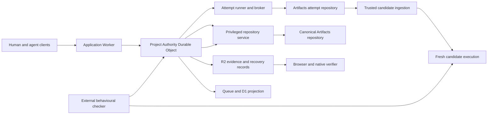
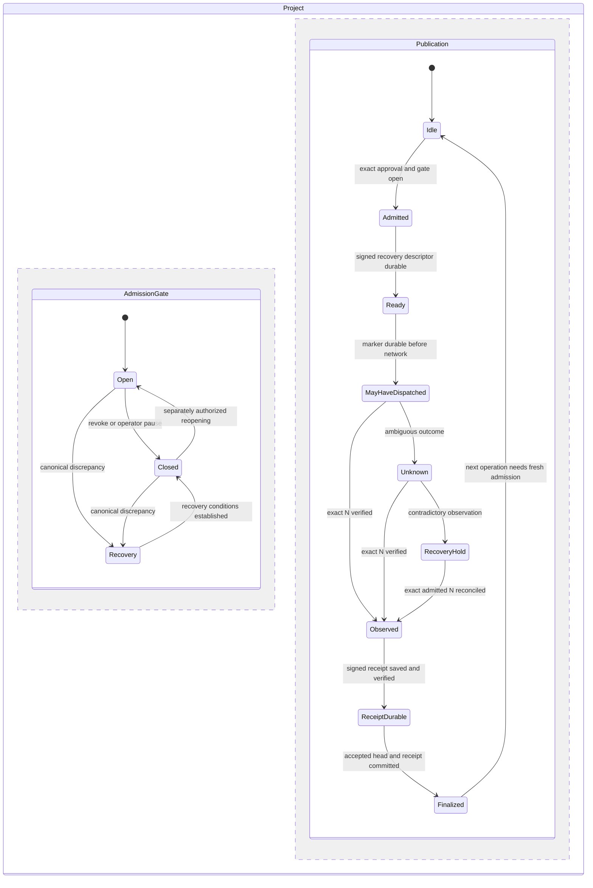

# Cloudflare Agent Collaboration Platform Design

Version 0.5. Revised 4 October 2026. Status: implementation baseline with research refinements and executable local reference experiments. The application, Rust verifier and Cloudflare integration code are implemented; implementation evidence (retained private reference; unavailable in this source distribution) records local checks and remaining live release gates. Reference-model results are not platform or agent benchmarks.

This specification describes a platform where agents explore changes concurrently, the system evaluates exact combinations, and an authorized publication produces a portable verification receipt. Failed combinations become structured inputs to further work. The intended reader is the team implementing and reviewing the competition entry, including coding agents working from this repository.

The repository copy is the design source. The accompanying private Page is a reading and review copy of this revision; the two are not automatically synchronized. Product naming remains open. Internal names in examples are descriptive and do not establish a brand.

## 1 Product decision

Build a collaboration and integration protocol above Git. The primary user controls a goal, its constraints, an execution budget and the decision to publish. Agents work on isolated attempts. The platform makes alternatives, interaction failures and the evidence supporting a release directly inspectable.

The differentiating experience is a clean Git merge that fails a behavioural contract: individually reasonable agent changes interact badly, the platform detects the interaction, and a successor repairs it using a precise counterexample. The platform preserves the successful work, the rejected alternatives and the reason for the final decision.

The central promise is that agents can propose arbitrary supported changes, but canonical history changes only through a bounded authorization and publication protocol. Receipts establish content identity, signed observations and the recorded authorization decision. They do not establish general program correctness.

The contest weights originality and prototype quality at 50 percent, coordination and related collaboration behaviour at 25 percent, and user experience at 25 percent. Workers, Artifacts, concurrent agents, an eligible permissive license, a demonstration video and run instructions are required. Submission closes 14 October 2026 at 11:59 p.m. PDT, which is 15 October at 7:59 a.m. BST. The team will target completion on 14 October UK time. On 5 October the user reported an organizer-approved location exception permitting this entry to submit and be prize eligible. Supporting correspondence stays private; the exception does not change the published general country conditions. Contest entry is manual. [Official rules](https://www.cloudflare.com/documents/build-next-gen-git-platform-competition-terms.pdf)

Success is measured by useful changes accepted per unit of human attention, elapsed time and cost. Agent count is a workload dimension, not the success metric. The demonstration must make the coordination benefit understandable before exposing hashes and signatures.

The research refinements concentrate on three visible advantages: explaining an interaction with a controlled replayable witness, continuing a repair with precise source and context provenance, and recovering uncertain effects without inventing success or cancellation. Statecharts, selective coordination, attributed intent, bounded classifier advice and selective CI reuse support those experiences. They introduce no new authority service or cryptographic primitive. Research decisions and experiments (retained private reference; unavailable in this source distribution) records the primary sources, adoption choices and limitations. These are hypotheses for a strong entry, not a prediction about competitors or judging. The [throughput and verification plan](THROUGHPUT.md) specifies how to reduce feedback latency, repeated setup and stale work while preserving the acceptance boundary, with explicit measurements and adoption gates.

## 2 Scope and delivery boundaries

The competition implementation supports one canonical branch per project, several concurrent attempts, immutable candidate snapshots, one externally checked behavioural contract, ordinary repository checks, human approval of the exact proposed publication, recovery after ambiguous publication, and downloadable receipts verified by browser and native CLI.

The protocol carries tenant and project identities from the beginning. The first deployment is a closed, authenticated pilot. Public signup and hostile multi-tenant operational readiness require additional isolation, capacity and abuse testing; carrying tenant IDs alone is not evidence of that readiness.

The first supported content profile is deliberately explicit: regular files and executable regular files; no symlinks, gitlinks, submodules or Git LFS hydration. Unsupported entries fail ingestion with an actionable explanation. Binary regular files may be stored within configured limits, but textual comparison is optional. Extending this profile is a schema and validation change, not an implicit fallback.

The implementation excludes a custom Git server, a new coding agent, a general merge theorem, arbitrary policy scripting, automatic production deployment, a decentralized consensus protocol and universal semantic conflict detection. It also excludes automatic recovery from an intentionally restored stale authority database. Those boundaries keep the first system inspectable and testable.

A later release can add alternative-release comparison, additional language-specific contracts, larger repositories, a witness service and more granular scheduling. These features must preserve the same admission and evidence semantics.

## 3 Objects and terminology

Six objects carry the protocol's core meaning. Additional records below describe their lifecycles and relationships.

| Object | Meaning | Authoritative producer |
| --- | --- | --- |
| Goal | Versioned outcome, constraints, contract references and budget ceiling | Authorized project user |
| Grant | Allowed operations and resources for a specific subject and lifetime | Project authority |
| Attempt | Isolated workspace and sequence of agent proposals | Agent under a grant; lifecycle recorded by the authority |
| Candidate | Exact immutable source state and composition description | Trusted ingestion and materialization service |
| Evidence | A typed observation about exact inputs under a specified checker and environment | Registered observation service |
| Decision | Recorded authorization or rejection; publication receipts describe subsequent observed effects | Project authority |

A Contract is a versioned acceptance requirement referenced by a Goal and policy. An Evaluation freezes a finite plan of named runs that can produce Evidence. A Conflict is a first-class derived record connecting a failed composition with its evidence and possible repairs. A Publication is the durable external effect requested by an admitted Decision. These records do not silently grant authority.

An Attempt's work base may be an accepted commit or a speculative Candidate. Its publication base is the accepted canonical head against which a future release would be installed. A repair agent may work from a failing composition without implying that composition was ever accepted.

An agent's signed rationale remains a claim. A checker signature identifies an observation source. Publication authority is a separate role. The system never interprets repository text, a chat transcript, a claimed path list or a signature alone as permission to publish. An optional intent declaration records what its issuer says this Attempt will deliver and which dependencies it assumes. A classifier prediction records a model's suggested category or action. Both use existing attributed observation/context records; neither is a seventh authority object, an acceptance obligation or a permission.

## 4 Required invariants

The following are implementation requirements. They become release gates through the validation matrix in section 20.

| ID | Invariant |
| --- | --- |
| I1 | Published source bytes and commit metadata match the frozen Candidate that the decision authorized. |
| I2 | Every required evaluation identifies that Candidate and the exact contract and environment inputs. |
| I3 | Admission uses current trusted project state, caller permission, policy, and applicable grant generations or approvals; client claims cannot substitute for them. |
| I4 | A delegated grant never expands its parent's operation or resource set, expiry or reserved budget. |
| I5 | Agent execution has no canonical write credential, namespace-level Artifacts binding, or publication signing key. |
| I6 | One canonical ref has at most one unresolved admitted publication. Retries retain the same old head, new commit and operation ID. |
| I7 | Timeout is uncertainty. A read of the old head alone cannot prove an in-flight publication was cancelled. |
| I8 | A command ID and authenticated caller scope identify exactly one request digest. Reuse with a different request is rejected. |
| I9 | Context, previews and repository output are untrusted data and cannot widen platform authority. |
| I10 | A receipt reports observed outcomes and its trust assumptions. Missing evidence is not converted into success. |
| I11 | Canonical history never rewinds through the application. A revert is a new reviewed child commit. |
| I12 | Required evidence is retained before its attempt workspace can be deleted. Unresolved publications pin their dependencies. |

Safety takes precedence over availability at the publication boundary. An unresolved remote effect can block that project's next publication while other attempts and projects continue within their budgets.

## 5 Threat model and trust boundaries

Treat agent output, imported source, dependencies, test commands, tool output, artifact names, preview HTML and inherited context as potentially hostile. A malicious or confused attempt may submit misleading metadata, alter its branch after submission, consume excessive resources, replay an old command or attempt operations outside its grant. Network responses can be delayed, duplicated or lost. Workers and containers can restart.

The trusted computing base comprises the project authority, privileged repository service, capability broker, checker controller, cryptographic libraries, relevant Cloudflare isolation and storage guarantees, and the people and deployment credentials that control those components. The system does not claim protection from a malicious account administrator who can replace all code, keys, storage and every observer's checkpoint. Independent retained checkpoints constrain some rollback claims; they do not remove the entire operator from the trust model.

Current Cloudflare documentation makes a sandbox the smallest execution trust unit: processes inside a deployed container have root-equivalent capabilities. A separate Linux user, a file permission or a second model persona does not isolate a trustworthy checker from candidate code in the same container. [Sandbox security](https://developers.cloudflare.com/sandbox/concepts/security/)

Use separate authoring and evaluation containers. Keep the external behavioural harness, signing keys and canonical publication outside both. Repository unit tests run with candidate code and produce a weaker observation class. Their exit status is useful but is never presented as independent proof that the code could not influence the test harness.

Authentication establishes a principal; project membership and a current role authorize an operation. Use a configured OIDC identity provider with issuer, audience, expiry and key verification, or an equivalent verified Access identity integration. The exact provider is an integration choice to settle before implementation. Never use a caller-supplied email address as identity. Human cookies require origin and CSRF protections; browser previews receive no administrative cookies and run on separate hostnames. Agent sessions use a different credential class and cannot invoke user approval endpoints.

Allowed model calls and output channels can carry source content. Network restrictions therefore enforce an explicit set of permitted destinations; they are not a universal information-flow proof. Sensitive prompts and raw traces are minimized, access controlled and excluded from public demonstration exports.

## 6 Service architecture

TypeScript owns Cloudflare integration, orchestration and the UI. Rust owns deterministic interpretation and decision rules. Artifacts stores Git state. A SQLite Durable Object owns current project authority. D1 is a searchable projection. R2 stores evidence, source bundles and publication recovery descriptors.

The diagram shows logical responsibilities. The following deployment boundaries prevent broad credentials from leaking through convenient bindings.

| Component | Responsibilities and access |
| --- | --- |
| Application Worker | Static assets, authenticated API, streaming updates and narrow project read and command service bindings. No Artifacts binding or signing key. |
| Authority and repository Worker | ProjectAuthority objects, Artifacts namespace binding, bounded ingestion and publication, recovery storage and decision signing. No candidate-controlled execution. |
| Attempt runner Worker | Container lifecycle, agent process, model broker and restricted attempt Git gateway. No namespace-level Artifacts capability or canonical token. |
| Evaluation Worker | Candidate containers, protected input delivery and observation reporting. No canonical mutation authority or authoring session. |
| Projection Worker | Idempotent event consumer and D1 writes. No authority to grant, evaluate or publish. |

The privileged repository Worker necessarily has broad access needed to fork canonical repositories. The documented fork interface does not establish cross-namespace forking, so namespace separation must not be assumed to solve this. Native forks may remain in a privileged namespace. Runner code receives only application-specific operations bound to a server-resolved attempt. It never receives an Artifacts repository capability or a generic token-mint endpoint. [Artifacts binding](https://developers.cloudflare.com/artifacts/api/workers-binding/)

The Git gateway derives tenant, project, incarnation, Attempt and generation from a controller-owned interception binding, such as trusted entrypoint props, never from an ownership header supplied by the container. It resolves the current Grant and exact remote from trusted state, validates HTTPS host, path and method, strips caller authentication, and adds a scoped token after traffic leaves the container. Redirects and unknown routes are rejected. Each generation starts with general Internet access disabled; only approved intercepts are configured before candidate execution. Re-establish and validate this configuration on recovery. The model gateway uses the same trusted identity boundary with separate permitted operations. An old generation cannot inherit its successor's identity. [Outbound interception](https://developers.cloudflare.com/containers/configuration/outbound-traffic/), [Private repository access](https://developers.cloudflare.com/sandbox/network/clone-a-private-repository/)

Model traffic uses a separate gateway with approved provider endpoints, model choices, reserved spend and bounded output. Optional classifier calls use the same reservations and provider policy, with a distinct registered recipe; they add no service or authority role. A Git grant cannot be used as a model grant. High-volume progress and log traffic is batched; it does not flow through the publication transaction path.

Workflows coordinate long-running steps. Queues deliver events and apply backpressure. Neither is the authority to publish. Duplicate delivery is expected and reconciled through stored command and event identities. [Queue delivery guarantees](https://developers.cloudflare.com/queues/reference/delivery-guarantees/)

Keep immutable observation ingestion and projections separate from current authority decisions. Evidence can accumulate by stable identity without establishing a single global order for every progress message. Budget reservations, revocation checks, approval consumption, evidence-plan closure and canonical publication remain coordinated in the project authority. An old observation remains a historical fact when its present policy eligibility changes. This application of monotonic reasoning does not make source merges, shared quotas or current trust coordination-free. [Keeping CALM, sections 1.4 and 3.4](https://arxiv.org/html/1901.01930)

## 7 Protocol identities and immutable records

Protocol examples describe the intended wire contract; they are not generated SDK types. Every record contains `schemaVersion`, `tenantId`, `projectId` and `projectIncarnation`. Opaque IDs are server-generated random identifiers. Possession of an ID grants no access. The same record ID in a different project is never interchangeable.

Digests use the fixed textual form `sha256:` followed by 64 lowercase hexadecimal characters. Git IDs remain separately typed as Git object IDs. Counter and budget fields use canonical unsigned decimal strings with explicit bounds; monetary reservations use integer micro-units. Timestamps used by policy are bounded Unix seconds supplied by the trusted authority. The UI renders them in the viewer's timezone. Clock movement is an operational condition; signatures alone are not trusted timestamping.

Signed JSON payloads use UTF-8 and a fixed RFC 8785 serialization profile. Reject duplicate object members before deserialization, malformed Unicode, unknown schema versions, noncanonical numeric strings and unsupported fields. Verify the payload bytes that will actually be interpreted. Arrays that represent sets have a specified order; order-sensitive arrays such as a composition recipe preserve their order. Stable encoding supports content identity; DSSE supplies the signature envelope. [RFC 8785](https://www.rfc-editor.org/rfc/rfc8785)

### Goal and Contract

A Goal revision binds its description digest, originator, constraints, contract IDs and revisions, maximum budget, and allowed execution policy. Editing a Goal creates a new revision. Existing attempts retain the revision they were assigned. A user may reassign a new revision only through a recorded command; evidence does not silently migrate.

Contracts specify the observable requirement, checker implementation digest, fixtures, result schema and mandatory evidence class. Agent-proposed tests are stored separately from protected acceptance contracts. Updating a contract requires the project policy role and creates a new policy or goal revision that invalidates applicable draft decisions. Review the changed requirement, checker and fixture identities, reason and known good/bad regression cases through that protected path. A repair agent cannot authorize its own replacement oracle. Checker changes do not rewrite historical observations or retroactively erase admitted authorization; a later-discovered checker defect is recorded and addressed through a new reviewed repair or revert.

### Grant

A Grant binds subject and parent grant, attempt and container generation, allowed named operations, resource IDs, finite path prefixes where applicable, permitted destinations, reserved budget, start and expiry times, and authority generation. Version 1 disables agent subdelegation. Future delegation must contain the child's validity interval within its parent's and recheck every ancestor's revocation and generation at effect admission. Human approval and publication admission can never be delegated to an agent by nesting an execution grant.

The initial execution operation vocabulary is closed: read assigned source, write assigned attempt, start the assigned execution, checkpoint its context, request model inference, submit attempt output, propose a selection, request evaluation, request repair and read authorized evidence. Each effect is constrained to its registered resources and budget. Creating a new Attempt and issuing its Grant are sponsor operations in version 1. An agent's repair request records a proposal; the sponsor's repair action creates the fresh Attempt and Grant. Starting an assigned execution does not authorize creating another attempt. Administrative operations use separate principals and routes. There is no arbitrary script evaluated as policy.

### Attempt

An Attempt binds the goal revision, grant, work base, publication base head at creation, isolated repository identity, environment definition, execution budget and agent adapter version. Workspace refs can change while work is running. Each submission resolves an exact Git object ID and becomes a new immutable observation; it does not turn a moving branch into an immutable identity.

Keep logical outcome separate from execution lifecycle. Completed, failed, cancelled and budget-exhausted outcomes do not by themselves prove resource termination. Infrastructure unknown is a nonterminal reconciliation phase. Preserve partial work and occupied capacity until the generation's stop is observed; separately reconcile already dispatched effects. A replacement generation requires the old generation's confirmed termination, a fresh reservation and lineage. It never overwrites prior observations.

An optional intent declaration binds the assigned Goal revision, public Contract references, short proposed outcome and bounded named dependencies. The authority binds producer, Attempt and generation from the authenticated checkpoint-context path. Revisions supersede earlier declarations explicitly and retain their history. The declaration is not required to start already authorized work. An adapter acknowledgment reports receipt of particular assignment bytes; a model-authored acknowledgment is a separate claim. Both remain attributed reports from the untrusted attempt. Neither establishes comprehension or delivery.

Promise Theory informs these distinctions: the sponsor's assignment, an agent's declared intent, a receiver's assessment and a Grant have different meanings. A dependency's existence can be checked by identity, while prose about its meaning remains unverified. Use declarations for explanation and advisory prioritization of already authorized work. A prose dependency cannot amend a frozen plan, create mandatory prerequisites, reserve resources or stall required checks. There is no negotiation engine or reputation-based permission. [Burgess, Cooperation in Human and Machine Agents, sections II–IV and VI](https://arxiv.org/html/2604.10505v1)

### Candidate

A Candidate binds the publication base head, exact final commit object, strong source manifest digest, contributing attempt submissions, ordered composition recipe and materializer version. Candidate creation freezes final commit metadata before approval and evaluation. The publication parent is the expected canonical head. Attempt histories remain separate lineage objects even when the published commit is a single integration commit.

A repair attempt may use a failed Candidate as its work base. Materialization applies the repair to that speculative state and constructs a new final commit whose parent is the actual publication base. The lineage records both facts explicitly.

Candidate identity excludes future evaluation IDs, approval signatures and publication receipts. Those refer to the Candidate. This prevents circular hashing and permits several evaluations of the same frozen content.

### Evidence

An Evidence record identifies the complete evaluation input digest, Candidate, checker class and identity, environment and fixture digests, run ID, start and completion observations, normalized outcome, output digests and limitations. Outcomes are `PASS`, `FAIL`, `ERROR`, `TIMEOUT`, `CANCELLED` or `INCONCLUSIVE`. Infrastructure error never becomes a product failure or a pass by accident.

Each evaluation request freezes a finite plan: required checker job IDs and exact inputs, cardinality, result aggregation rule and any explicitly eligible retained evidence. This plan is an immutable record under Evaluation, not a new service or core authority object. A rerun gets a new job ID and a new immutable Evaluation/plan; it never replaces a required job inside an existing plan. A resulting review has a new digest. Earlier failures and contradiction rules remain applicable and cannot be discarded by creating a new plan. Two different terminal outcomes under one job ID are a protocol-integrity error; contradictory outcomes from distinct valid runs are evidence of uncertainty. Completion means the named obligations are resolved, not that no future observation can fail. The frozen plan can additionally declare job prerequisites and an explicit fail-fast rule. Prerequisites name jobs in that same frozen plan and form a validated acyclic graph. A decisive required FAIL may cancel unstarted downstream jobs with the prerequisite and policy reason recorded; running jobs retain normal cancellation reconciliation. Unstarted means start dispatch is durably fenced, not merely unacknowledged. Serialize cancellation/completion terminal transitions and retain late raw observations; conflicting terminal Evidence remains an integrity error. ERROR and timeout do not become product FAIL. Cancelled or unrun checks never satisfy a PASS obligation, and no claim that every checker executed follows from settling such a plan. Plans without this rule retain their original obligations.

The attester derives identity and inputs from its trusted job record rather than submitted JSON. It signs observations obtained through the control plane. A string printed by a candidate process cannot create a trusted PASS record.

### Decision and receipts

A review proposal binds the Candidate, goal and policy revisions, expected head, finite evaluation plan and evidence set, observation watermark, required reviewer roles and decision expiry. The authority creates its digest from a closed schema. Admission rechecks the relevant observation revision as well as the other mutable authorization inputs. A newly recorded contradiction can invalidate an unadmitted review under policy. It cannot rewrite an earlier observation or retroactively change the recorded authorization of an admitted publication. A human approval binds that exact proposal digest and reviewer identity. It is one use, with no client-controlled widening of scope.

An AdmissionReceipt records that a publication request was authorized at a particular ordered authority event under specified state. A PublicationReceipt records the later observed remote result and links the admission, exact commit, source manifest, prior publication receipt and evidence. A negative Decision records the structured rejection reason. Keeping admission and outcome distinct makes the receipt truthful across network failure.

Receipts are detached from the commit they identify. Any commit trailer used for correlation contains only a previously allocated non-secret operation ID. It cannot contain the digest of a receipt that also hashes that commit.

## 8 Source manifests and content ingestion

The strong source manifest lists path, Git mode, byte length and SHA-256 of actual file bytes, in ascending unsigned ASCII path-byte order. It identifies its schema and path profile. Every supported leaf of the exact frozen commit tree must appear once and only once with matching mode, length and content; a valid manifest and valid commit do not suffice without checking that relationship. Reject duplicate paths and file/directory prefix collisions. Git SHA-1 object IDs remain transport and lookup identifiers; hashing a Git ID with SHA-256 is not a replacement for hashing its referenced content.

The first path profile admits printable ASCII components with `/` separators, excluding backslash and `< > : " | ? *`. Reject empty components, `.`, `..`, absolute paths, trailing dots/spaces and any component equal to `.git` ignoring ASCII case. Also reject case-insensitive Windows device basenames `CON`, `PRN`, `AUX`, `NUL`, `COM1`–`COM9` and `LPT1`–`LPT9`, including when followed by an extension. Reject case-fold collisions in every path prefix, not just full file names. Store admitted bytes exactly without normalization. Component, path and aggregate-path bounds are specified in section 19. This closed application profile is not a claim to support every platform filename.

The v1 content modes are Git regular file modes `100644` and `100755`. Unsupported modes fail ingestion before a file is extracted. Compute changed paths and modes from the actual base and candidate trees. Treat renames as deletion and addition for authorization; rename detection is only a UI aid. A path-prefix grant is evaluated against path components, not a naive string prefix.

Ingestion resolves immutable Git objects, validates graph and size bounds, reads and hashes content incrementally, checks the actual change set against grants, and stores complete content-addressed objects before recording the Candidate as ready. An orphan object after a failed metadata transaction is harmless and eligible for later collection; a metadata record pointing to missing required content is not ready.

Evaluation hydrates files directly from the verified manifest, preserves supported executable modes, and checks the resulting bytes before starting candidate-controlled execution. It does not rely on a checkout that can apply unrecorded line-ending conversion, smudge filters or other content transformations. Build-time changes made by candidate code are part of the observed execution, not a change to the immutable source identity.

The materializer never checks out candidate-controlled hooks, Git filters or build configuration into its own execution path. Use a pinned established Git/object library behind a bounded adapter; selection is settled by the platform spike. Do not implement packfile parsing from scratch for the competition.

Privileged ingestion has strict CPU, recursion, object-count and decompressed-byte ceilings. A repository compatible with the storage service can still exceed this application's supported profile. Report that limit explicitly instead of partially verifying a repository and displaying a complete-verification badge.

## 9 Attempt provisioning and context

The authority first admits an attempt, reserves its execution quota and records its intended immutable base. Provisioning uses a deterministic repository name derived from the attempt ID. If a fork request times out, inspect that exact resource and validate its association before retrying. Never create a second randomly named repository merely because the first response was lost. A conflicting pre-existing resource is a reconciliation error.

Fork completion does not establish the intended base: the source may have advanced during creation. The runner must establish its work ref at the captured commit, and trusted ingestion must verify that base and its strong source manifest before starting agent work. Test readiness and history preservation against the actual Artifacts service. A speculative repair base may require copying its verified objects into the fork; that transfer is an explicit provisioning step.

Initial tokens returned by create or fork are tracked and revoked after the broker establishes its intended credential. Token lifetime, rotation and removal are resource lifecycle operations with stored outcomes. The broker never puts a token into a remote URL, environment variable or file visible to candidate code.

An execution recipe pins the agent adapter, supported model configuration, initial instructions, image digest, permitted tools, dependency policy and resource limits. Use Pi 1.0's coding-agent SDK as the first adapter inside the untrusted authoring container. Pin the package, dependency integrity and image; release v1.0.0 requires Node at least 22.19.0 and is MIT licensed. The selection remains subject to the brokered vertical-slice experiment. [Pinned package manifest](https://github.com/earendil-works/pi/blob/v1.0.0/packages/coding-agent/package.json), [License](https://github.com/earendil-works/pi/blob/v1.0.0/LICENSE)

Construct the Pi SDK session with explicit tools, model route, settings, resource loader and session location. Disable automatic repository extension/package/MCP discovery and system-prompt replacement. Selected repository instructions can enter as labelled untrusted context. Pi 1.0 supports native MCP/Codemode, but the SDK makes those extensions opt-in; neither is required in this first adapter. Provider credentials remain outside the container at the existing model broker. Pi tool hooks and working directories are not security boundaries. [SDK](https://pi.dev/docs/latest/sdk), [Security model](https://pi.dev/docs/latest/security)

Pi Durable, announced as experimental on 1 October, is deferred as an orchestration substrate. The application already needs authority, outbox and effect-reconciliation semantics. A second durable scheduler would require storage, replay and migration conformance work. Pi's conversation request-ID deduplication is not this protocol's caller-scoped request-digest binding, and replay-safe tool declarations cannot establish an external effect's outcome. Those checks stay at the platform boundary. [Announcement](https://earendil.com/posts/pi-durable/), [Pinned submission handling](https://github.com/earendil-works/pi/blob/v1.0.0/packages/durable/src/harness/submissions.ts), [Pinned tool recovery](https://github.com/earendil-works/pi/blob/v1.0.0/packages/durable/src/harness/tool.ts)

An attempt context capsule binds the goal revision, exact source checkpoint and strong manifest, retained session snapshot digest and format, selected branch/entry reference, adapter identity, execution generation, context-selector version and rendered-context digest. It also records relevant Evidence/Conflict references, bounded rationale, producer and trust class for every item, and missing or uncertain tail flags. This manifest associates source and conversation; it does not claim an atomic snapshot of a live filesystem and model.

Pi's session tree helps select history, but changing its active branch does not restore source or undo external effects. Continue an alternative by provisioning a new Attempt from both named retained references and issuing a fresh Grant and reservation. Missing data fails visibly. A session entry ID alone is not a cryptographic commitment; hash retained bytes. Distinguish agent-reported transcript, host-observed tool envelope and broker-observed model request. Extensions can transform context, so a signed transcript does not prove the exact provider request or truthful reasoning. [Sessions](https://pi.dev/docs/latest/sessions), [Extension contracts](https://pi.dev/docs/latest/extensions)

For repair, start with a deterministic bounded selector: goal, failed Candidate, protected contract's public description, observed counterexample, selected contributions and links to original evidence. Keep private fixtures outside the capsule. Summaries remain claims and cannot replace checker evidence. This needs no embedding service or second model. Record the selection and capture limitations; measure repair success and context cost before adding automated retrieval. Context is never interpreted as policy instructions.

Ordinary authoring checkpoints can use container snapshots or Git commits. Acceptance always reconstructs from verified immutable content into a fresh environment. An authoring snapshot is never promoted into a trusted evaluator image. Missing checkpoint data produces a visible resume failure, not an invented continuation.

Frequent edit feedback runs inside the existing authorized authoring generation: incremental compilation, focused tests and public property probes can retain local tool state. Record producer, generation, command, available source checkpoint and snapshot uncertainty when files change during a check. These are diagnostic observations, even when a host records the command exit; they cannot satisfy the protected acceptance class. The generation's reservation and broker checks remain effective, while progress is batched outside the publication transaction path. No new sandbox is needed for each local syntax check.

## 10 Composition and coordination

Version 1 uses bounded optimistic work. Attempts can run concurrently without claiming exclusive ownership of entire files. Declared path intentions, reads and dependency hints improve scheduling and visibility but do not authorize writes or establish semantic independence.

For the initial composition adapter, compare each immutable attempt submission against its pinned work base. Automatically combine only mechanically unambiguous deltas from a common publication baseline. Different writes to the same path or conflicting mode/deletion operations produce a mechanical Conflict. Identical writes can deduplicate after byte and mode equality is checked. The first adapter does not silently apply an arbitrary three-way textual merge. A repair attempt can resolve overlapping work with full context.

This conservative composition scope is sufficient for the demonstration's disjoint-file interaction. The system separately evaluates the resulting combined Candidate. A clean mechanical composition has no implied behavioural guarantee.

A selection request names a bounded set of attempt submissions, a publication base and a composition recipe version. Materialization produces an immutable Candidate or an explicit mechanical failure. For stale-base continuation, retain original publication base P and desired tree T. Transplant only whole-file entries changed from P to T onto new accepted base B: if B's entry equals P's, apply T's; if it already equals T's, deduplicate; otherwise return a mechanical Conflict. Equality includes presence, mode and strong content identity. Unchanged paths inherit B. Validate the complete resulting tree, including file/directory collisions, then create a new Candidate, evaluation and review. No textual merge or semantic independence follows, and the original P never changes.

The contest default permits at most four alternatives per goal in automatic exploration and evaluates only explicitly selected combinations plus a small configured exploration budget. There is no exponential search guarantee. Selection priorities come from user goals and measured outcomes; agent self-scores cannot override hard contracts or policy.

A Conflict record contains its category, source submissions, integrated Candidate when available, failing contract or mechanical condition, Evidence references, reproducible observation and status. Categories are mechanical overlap, behavioural interaction, incompatible alternatives, policy refusal and insufficient evidence. A policy refusal is not disguised as a merge conflict.

Repair creates a new Attempt and fresh Grant. It can start from the exact failing Candidate F, receive the counterexample and preserve earlier explanations. Check the repair's F-to-result delta under its own Grant and retain the admitted contribution lineage explaining the inherited P-to-F changes. Checking only the repair delta cannot authorize all inherited work. Historical execution Grants need not become live again; current project policy still governs publication. Materialize the final source under the composition rules, and require the same evaluation and approval process. Repair cannot weaken the protected contract or silently drop selected useful obligations.

Observed failed combinations are retained with all relevant input identities. Do not infer that every superset of a failing combination fails: another change may repair it. Nor does pairwise compatibility establish compatibility of a larger set.

For the demonstration, produce an interaction witness from four fresh runs of the same protected contract: baseline, A, B and A+B. Each run records its exact Candidate, plan, fixture reset, image and outcomes. The witness states that the tested combination failed while its tested components passed. It does not prove that A and B are the only possible cause or that they fail in every environment. Include the short reproducer and direct Evidence references; a signature authenticates these observations, not a causal theorem.

Optional diagnostic work has its own reserved budget. It can remove irrelevant submissions and delete actions from the failing request trace while preserving the same observed failure predicate. Mechanical composition failure, invalid traces, timeout and infrastructure error are unresolved probes, never evidence that the behavioural defect disappeared. Report a trace as one-deletion-minimal only after every permitted single deletion of the final trace was actually checked and no unresolved probe remains; otherwise report the best reduction found. Do not label this a globally smallest reproducer. [Delta debugging](https://web.stanford.edu/class/archive/cs/cs295/cs295.1086/papers/issta2000.pdf)

Retain verified counterexamples as a regression bank with source, contract and fixture identities. A repair sees the smallest available reproducer and the original full failing trace, then runs the unchanged protected contract. Model-generated tests enter as proposals. Making them additional acceptance obligations requires the existing authorized contract/recipe revision process; diagnostic learning cannot silently change policy.

### Optional classifier advice

Our first classifier experiment is shadow ranking of already eligible diagnostic priorities or repair recipes. The registered recipe presents a bounded shortlist, current goal, attributed intent, observed failure and relevant public contract information. Its output is recorded beside the deterministic baseline without changing execution. If held-out evaluation establishes value, an authorized policy revision may let the ranking choose among optional diagnostic jobs inside their reserved budget. Required checks retain priority and cannot be starved. A repair recommendation remains a proposal; the sponsor still creates its Attempt and Grant. Learned context selection, role assignment and dynamic model routing are deferred.

Prefer Clef through the existing Workers AI route when account access and its actual response semantics are confirmed; compare Jev only through a separately configured provider and permitted data route. Clef and Clef-flash are Cloudflare's open-weight models, documented at 27B and 9B parameters. Jev is a separate TypeSafe service. Similar request schemas do not establish identical models, scores or operating characteristics. Neither belongs inside the small Rust/WASM protocol kernel. The platform remains fully functional without classifier access. [Clef](https://developers.cloudflare.com/workers-ai/models/clef/), [Clef-flash](https://developers.cloudflare.com/workers-ai/models/clef-flash/), [Jev models](https://docs.typesafe.ai/models)

A prediction record binds the requested and returned model identifiers, endpoint, time, adapter and preprocessing versions, complete question schema, input references, emitted request digest, raw probability vectors, usage and explicit capture/truncation limitations. Record immutable model revision only when established; a hosted alias or echoed request name does not prove the deployed weights. Preserve question IDs, full co-batched schema and presentation order. JCS canonicalization of an abstract object is insufficient if a differently ordered serialization is sent to inference. Use one specified serialization or separately bind the actual emitted bytes. Requested input must fit our conservative byte/token budget before dispatch; unknown provider truncation prevents a complete-input claim.

Confidence is model-specific data. TypeSafe documents Choice confidence normalized above uniform probability, whereas the published Clef helper returns the largest probability for Choice and Score. For the illustrative vector `(0.6, 0.3, 0.1)`, these produce `0.4` and `0.6`; this is arithmetic from the definitions, not a hosted measurement. Preserve the vector and label our own derived metrics, such as top probability and margin. Establish thresholds separately for provider, model, task and schema, with measured calibration; do not multiply related question probabilities or import a universal confidence cutoff. Hosted Clef's exact semantics remain a conformance question. [TypeSafe confidence](https://docs.typesafe.ai/confidence), [Pinned Clef helper](https://huggingface.co/Cloudflare/clef/blob/2f3de3dd85f379784083b0814d997ab627200f0c/joint_schema_model.py)

Only platform-owned templates choose the question schema, eligible actions and provider destination. Treat all source, logs and intent as untrusted classification data. Bound and validate response size, exact question/option identities, finite probability values, normalization tolerance and declared result consistency; reject malformed or incomplete responses. Known missing context, unsupported input, ambiguous ranking, timeout or unavailable calibration returns the deterministic baseline, even when the raw prediction is confident. This is bounded abstention, not a claim to detect every unfamiliar input. A classifier cannot authorize work, establish semantic independence, suppress known contradictory evidence, turn a command exit into an external PASS or declare publication safe. The deterministic repair capsule in section 9 always includes its required core.

## 11 Evaluation and evidence reuse

Evaluation has three independent responsibilities. The trusted orchestrator selects immutable inputs and records execution observations. The candidate container builds and runs source. An external harness tests supported behaviour across that interface. It resolves the endpoint and generation from trusted job state, restricts requests to recipe destinations, rejects redirects outside that binding and parses bounded inert responses. Candidate source cannot replace the harness or access its unreleased corpus, expected answers or signing material. Actual inputs delivered to the candidate are necessarily observable; a released counterexample is repair context, not untouched audit data.

The evaluation identity binds every input the supported recipe treats as observable:

| Input group | Required identity |
| --- | --- |
| Source | Candidate digest, exact commit bytes digest, strong source manifest and composition recipe |
| Meaning | Goal revision, contract bundle, evaluation policy and checker semantic version |
| Invocation | Entrypoint, arguments, build flags, declared output checks and environment allowlist values |
| Runtime | Image digest, architecture, runtime and compiler identities, resolved dependency digests and lockfiles |
| State | Database or service fixture, input corpus, seed, clock mode, locale and timezone |
| Boundary | Network policy, mounted inputs, resource ceilings, wall-time limit and available capabilities |

The versioned digest of this complete canonical tuple is evaluationInputDigest, the input/applicability identity. Execution identity is separate: command, immutable plan and job/run ID, with explicit fresh-run intent. A requested independent rerun bypasses reuse and coalescing even when its input digest matches. One observed run cannot count twice toward independent-run cardinality. Changing only job or plan identity does not erase contradictions between runs of the same inputs. The observation adds producer identity, actual outputs and outcome. Pinning a lockfile without pinning or verifying the fetched artifacts is not sufficient to claim a reproducible environment.

The demo recipe uses versioned isolated fixtures and a pinned dependency image. The external harness owns the fixture store and its access observations; candidate execution receives only the registered application data route for that job. Its request sequences test freshness and retained value as specified in section 18. The harness records responses and exact counterexamples; it does not trust candidate-reported cache counters. Optional repository test evidence is visibly labelled as an in-container observation.

Prepare resolved dependencies in the pinned image and hydrate acceptance source directly from the verified Candidate; evaluation needs no additional Git fork or history clone. A small pristine ready-instance pool is optional after measuring startup cost. Reserve capacity, establish readiness and atomically claim a never-used instance for one job/generation. Once candidate-controlled state reaches it, never return it to the pool by clearing its workspace. Unknown start/claim/stop outcomes retain their identity and reservations until reconciled. A trusted prepared environment can be warm while candidate execution remains fresh; authoring snapshots remain ineligible. See the [detailed preparation and cache boundaries](THROUGHPUT.md).

Reuse is disabled by default. Enable it only for recipes with bounded and captured observable inputs. Live external services, unresolved dependencies, uncontrolled clock or randomness, unrecorded environment values and unavailable secret-version information make a run non-cacheable. Cache lookup also checks current trust in the issuer, required evidence lifetime and availability of the referenced artifacts.

The first release does not use private input hashes as public evidence of secrets: the fixture needs no secrets. Future private evaluations need explicit secret-version references and private verification policy. A hash of a guessable secret can disclose information and is not an appropriate public identifier.

Only a PASS from every required recognized checker class can satisfy acceptance. A failed behavioural contract is retained. Infrastructure retries are bounded and recorded; they do not overwrite earlier observations. Contradictory behavioural outcomes mark the candidate INCONCLUSIVE until the contract's explicit flakiness policy is satisfied. Version 1 has no automatic repeat-until-green policy.

Evidence reuse is never inferred from disjoint changed paths, declared reads, a model's opinion of equivalence or individual attempts passing on the baseline. The exact integrated Candidate needs its own applicable evidence.

Separate the scheduler, which chooses the next permitted job, from the applicability check, which decides whether retained evidence satisfies the complete input and trust requirements. Evaluate the selected integrated Candidate first; contribution comparisons and four-way witnesses are bounded diagnostics unless the frozen contract or demonstration explicitly requires them. Independent required jobs may run concurrently within reservations using separate fixture state; do not split a stateful contract trace into independent jobs. Cheap-first ordering and fail-fast behavior must be declared in the plan rather than introduced retrospectively. The default priority is the user's selected integrated Candidate, missing mandatory checks, then a bounded diagnostic comparison. Transport retries of the same command return its one recorded job and reservation. Broader sharing between distinct live requests is deferred; it would require per-plan pins, cancellation ownership and explicit reuse eligibility. Candidate or policy changes do not inherit an earlier job's acceptance result. Version 1 still has no partial-source cache. Record why reuse was rejected, so its cost can be measured before introducing a dependency tracker. This is a small application of the scheduler/rebuilder separation in [Build Systems à la Carte, sections 4 and 5](https://www.microsoft.com/en-us/research/uploads/prod/2018/03/build-systems.pdf).

### Cloudflare CI as an execution dependency

Cloudflare CI is a useful reference and a conditional dependency behind the existing evaluator adapter. Reviewed version `@cloudflare/ci` 0.2.0 at commit `fbbc2902c07c8ac89612f915f28c58c9b0941dbd` combines Workers Workflows, Sandbox execution and Artifacts integration. It pins Sandbox 0.12.1; our direct adapter targets current Sandbox 1.0. At this revision the runner is constructed internally, so a compatible, narrowly privileged adapter is not demonstrated by subclassing alone. Time-box a feasibility spike before adopting the package. Keep direct Sandbox 1.0 execution if reuse requires replacing most internals. [Package](https://github.com/cloudflare/ci/blob/fbbc2902c07c8ac89612f915f28c58c9b0941dbd/package.json), [Runner construction](https://github.com/cloudflare/ci/blob/fbbc2902c07c8ac89612f915f28c58c9b0941dbd/src/ci/capabilities.ts)

Pipeline TypeScript runs as deployed, privileged Worker code. The upstream example statically imports its workflow; it does not dynamically execute a candidate's pipeline file in the Worker. Preserve that boundary. Only protected, registered recipes receive platform bindings. Candidate files may supply bounded data to a permitted recipe, never Worker imports, secret names or privileged callbacks. Our adapter keeps credentials at the external broker and retains a fresh candidate container plus a separate behavioural harness. A CI command's exit status remains the weaker in-container observation class. [Example entrypoint](https://github.com/cloudflare/ci/blob/fbbc2902c07c8ac89612f915f28c58c9b0941dbd/examples/cloudflare-artifacts/src/index.ts), [Workflow definition](https://github.com/cloudflare/ci/blob/fbbc2902c07c8ac89612f915f28c58c9b0941dbd/examples/cloudflare-artifacts/cloudflare.ci.ts)

Reuse must satisfy three existing contracts. First, materialization fails closed and independently verifies the complete Candidate; restored authoring workspaces and source overlays cannot stand in for clean evaluation inputs. Second, mandatory checks actually run: the upstream cache can return synthetic success without executing a command, so keep it disabled for acceptance. Third, authority-issued job identities distinguish delivery retries from an explicitly fresh run. Disable automatic behavioural reruns; preserve failures and reconcile an unknown start before admitting another execution for that affected job/generation. Upstream source-only run deduplication and default Workflow retries do not supply those semantics. These are compatibility requirements identified by static review, not reproduced provider faults. [Sandbox runner](https://github.com/cloudflare/ci/blob/fbbc2902c07c8ac89612f915f28c58c9b0941dbd/src/ci/runners/sandbox.ts), [Cache and execution](https://github.com/cloudflare/ci/blob/fbbc2902c07c8ac89612f915f28c58c9b0941dbd/src/ci/capabilities.ts), [Run identity](https://github.com/cloudflare/ci/blob/fbbc2902c07c8ac89612f915f28c58c9b0941dbd/src/ci/run-id.ts), [Workflow retries](https://github.com/cloudflare/ci/blob/fbbc2902c07c8ac89612f915f28c58c9b0941dbd/src/pipeline/ci-workflow.ts)

Borrow compact runner descriptions, bounded diagnostics and explicit job dependencies where useful. There remains one application-owned scheduler, one authority and the section 13 publisher. The upstream self-healing example informs failure presentation; it does not replace the Pi adapter, sponsor-authorized repair, protected checker or exact publication approval. Its deployment and branch-writing paths are outside this integration. [Self-healing example](https://github.com/cloudflare/ci/blob/fbbc2902c07c8ac89612f915f28c58c9b0941dbd/examples/self-healing/README.md)

## 12 Capability and budget enforcement

The trusted authority resolves each request to the subject's current Grant. It checks project incarnation, attempt and container generation, operation, resource, expiry, revocation state and budget before admitting the effect. Client-provided IDs select a request; they do not supply authoritative resource bindings.

Represent resource scope using a finite operation set, explicit resource IDs, admitted path prefixes and explicit destinations. Child scope inclusion is computed over that closed representation. Do not introduce arbitrary glob languages, URLs or policy code whose containment cannot be checked reliably.

Budget accounting uses reserve, dispatch, settle and release transitions. Reserve a call or job's maximum permitted consumption before dispatch; concurrent children draw from the same parent allocation. Release unused reservations only when the outcome is sufficiently known. An ambiguous model request holds its reservation until reconciled or conservatively settled at the reserved maximum.

Local admission limits bound tool-call counts, input/output bytes, requested maximum generation tokens, reserved running slots and execution deadlines. A persisted deadline triggers broker fencing and whole-container shutdown; it is not proof of instantaneous physical termination or a hard cloud billing cap. Retain occupied capacity until stop is observed. Monetary totals remain conservative estimates based on a recorded pricing snapshot unless the provider exposes an enforceable billing limit. The UI distinguishes those estimates from guaranteed caps.

Cancellation first denies new admissions, then requests container stop, credential revocation and cleanup. It reports stop requested until runtime state is observed. Already dispatched remote requests can complete; stopping a process does not undo a remote effect. Cancellation receipts identify which controls were confirmed and what remains uncertain.

Publication uses separate authorization semantics. The authority checks current sponsor publication permission, the approving reviewer's required role, current policy, exact approval and time at publication admission, then consumes the one-use approval in the same local transaction. Contributor execution authorization is checked when submissions are admitted and retained as historical evidence. Expiry or revocation of an execution Grant fences new broker effects and starts execution shutdown; it does not attest that already running computation or remote calls have stopped. Rejecting already admitted contributions requires an explicit project-policy decision. Completed work does not need a still-live execution Grant to be published. A later revocation of publication permission fences later admissions. It does not retroactively revoke a remote effect already admitted under the recorded policy. The user sees that boundary in the pending publication state.

## 13 Publication protocol and failure recovery

### Enrollment and the first accepted head

Before opening admissions, an authenticated operator enrolls one pilot repository/ref with verified baseline B, exact commit bytes and strong source manifest, tenant/project/incarnation, initial roles, policy and independently pinned trust configuration. The enrollment descriptor uses the existing Project/Decision machinery and is signed under that trust configuration. It establishes sequence zero with no prior publication receipt. The first publication links the enrollment digest explicitly; subsequent publications link the prior logical receipt digest. All receipts bind the enrollment digest and incarnation.

Enrollment verifies the ref still equals B and establishes the application as its sole normal writer before activation; account administrators remain trusted. An empty repository needs an explicitly supplied seed commit before enrollment. Imported history is an accepted starting point, not history evaluated or published by this platform. Re-enrollment cannot silently reset a retained checkpoint and follows the restore preconditions below.

### Required backend behaviour

The required remote operation is an atomic conditional ref update from expected old commit B to precomputed new commit N. N is a child of B. Artifacts documents Git receive-pack v1, but its complete behaviour under concurrent and delayed pushes must be tested. Automatic canonical publication is blocked until this primitive is demonstrated. The implementation does not require multi-ref atomicity. [Artifacts Git protocol](https://developers.cloudflare.com/artifacts/api/git-protocol/)

The Git adapter must retain B and N across retries. A library that silently fetches a new head and changes the expected-old value is unsuitable for this path. Rebase, merge and force reset are never retry strategies. Updated source creates a new Candidate and review proposal.

### Preparation and admission

Candidate construction freezes commit bytes before evaluation and approval. Once required evidence exists, the authority creates a review proposal with Candidate, expected head, policy and evidence identities. The human approves that proposal's digest through an authenticated session. The prototype requires this approval for every canonical source change.

Within one short authority transaction, admission rechecks current sponsor membership and publication permission, the reviewer's required role, project state, expected head, policy generation, unconsumed approval and evidence validity. It consumes the approval, reserves the next publication sequence, inserts the immutable old/new operation and appends an outbox entry. This transaction is the authorization linearization point.

The same transaction freezes the AdmissionWitness under that record: exact command/proposal and referenced Candidate, policy and plan identities; relevant pre-state values/revisions including membership, roles, head, gate, approval-consumption state and evidence/observation closure; trusted admission time; kernel/predicate version; decision and resulting state delta. The delta contains semantic changes such as approval consumption, slot/sequence reservation and fixed operation/outbox IDs; it excludes the witness's own digest, signatures and derived storage-reference fields, preventing a self-hash dependency. Bind its canonical digest in the signed admission. Store bounded witness records and digest references to separately bounded immutable inputs, and retain/export all inputs required to replay this transition. The witness is authority-attested recorded state, not independent evidence that the authority disclosed every historical event.

Signing and network I/O occur outside that synchronous transaction. The stored admitted fields are immutable. A signing failure leaves the publication pending; it cannot cause reconstruction under a different candidate or policy. Before any Git mutation, write and confirm a signed admission and prepared descriptor to the external recovery journal. A record written without a later push is a legitimate pending operation.

The prepared descriptor includes operation ID, project incarnation, enrollment digest, sequence, predecessor receipt or explicit genesis reference, B, N, strong Candidate identity, review proposal digest and AdmissionWitness digest. Immutable R2 keys and read-back validation protect ordinary recovery from missing local state. R2 is within the operator's trust boundary, not an independent witness.

### Dispatch and finalization

Before each network dispatch, persist a dispatch-attempt ID and a monotonic `dispatchMayHaveOccurred` marker. A crash after setting that marker is conservatively treated as a possible remote effect, even if the network call may not have begun. The publisher sends only the admitted B to N update. After observing the expected ref, it retrieves the referenced content through the trusted path and verifies commit bytes and the strong source manifest.

After verified observation, a local transaction freezes one logical PublicationReceipt: admitted identities, observed outcome and observation identity/time, historical authority revision, enrollment and predecessor digest. Concurrent finalizers reuse that object; later observations are additional evidence, not a replacement outcome. Its canonical digest identifies the chain link. A DSSE endorsement binds the logical object and separate issuance context, including signer-keyset revision. Future signing metadata is not frozen into the logical outcome.

Persist and read-back verify the complete signed envelope, then atomically select its digest as the publication's canonical envelope reference. Competing finalizers return the selected reference. Finalization requires that selection to be durable and advances accepted head/sequence, releases the unresolved slot and emits events. Export cannot precede finalization. Signing/storage failure leaves confirmation pending. Later authorized endorsements may be added without changing the logical receipt, selected historical envelope or previous exports. Equivalent single-assignment rules apply to admitted fields and prepared descriptors.

One canonical ref has only one unresolved admitted publication. Work on other attempts can continue. The physical Git ref may advance before the local receipt is finalized; raw Git readers can observe that interval. The application shows confirmation pending until finalization. It does not claim a distributed transaction across Artifacts, the authority database and R2.

Do not attach production deployment directly to canonical push events in the prototype. If deployment is added later, a separate scoped service consumes a finalized publication receipt and records deployment as a distinct effect with its own outcome.

The two regions are independent coordinates. Closing admissions does not erase a pending operation or disable observations, reconciliation and finalization for it. RecoveryHold retains the unresolved slot and may return to Observed only after the exact admitted N is independently reconciled under section 13's recovery conditions; it never adopts an unauthorized descendant. The admission gate remains closed until separately authorized reopening. There is no timeout-to-aborted transition. Unavailable signing, storage or read-back leaves the relevant operation pending with a reason code.

Harel's hierarchy and orthogonality motivate this factoring; they do not supply crash recovery or database atomicity. Implement a bounded pure transition function with explicit event/guard priority and run-to-completion local steps. Reject ambiguous transition definitions. A local step commits new state and named outbox effects; network results return as later events. Do not run network calls on state entry, use history-state restoration to replay effects, or assume an asynchronous handler is one atomic step. No general statechart interpreter is required. [Harel 1987, sections 2, 3 and 7](https://www.state-machine.com/doc/Harel87.pdf), [SCXML processing model](https://www.w3.org/TR/scxml/#AlgorithmforSCXMLInterpretation)

### Ambiguous outcomes

If a B to N push times out and a read still returns B, the push may remain in flight. Keep its reservation and reconcile. Local cancellation, token expiry or an authority epoch update does not prove that an already authenticated backend request cannot finish.

| Observation | Required response |
| --- | --- |
| Ref is N and verified bytes match | Finalize the existing operation idempotently. |
| Ref is B after any possible dispatch | Keep unresolved. Reading old state is not proof of non-application. |
| Ref is a verified descendant containing N | Enter recovery and halt new publication. Verifying Git objects does not authorize the unexpected descendant. |
| A verified competing successor has consumed B | Where proven CAS establishes fencing, record that fact and halt for canonical divergence. Do not adopt the competing head or resume admissions merely because its objects verify. |
| Ref is missing, rewound or unknown | Halt publication and require investigation. Never force-reset to the local database value. |
| Duplicate delivery repeats the operation | Return or reconcile its stored outcome; do not create another commit. |

A definitive transport-level rejection is evaluated in the context of all previous dispatches. Rejection of one duplicate request does not prove an earlier duplicate failed. Unknown operations remain pinned until resolved.

A future cancellation mechanism can publish a separately authorized no-change fence commit F as a competing child of B. If B to F wins, a delayed B to N cannot later win under the proven old-head check. If N wins, recover N. This is a real administrative canonical change and is outside the competition baseline. Do not invent a safe elapsed-time cutoff in its absence.

### Ordinary restart and stale database restoration

Ordinary actor restart reloads durable state, reconstructs pending operations and resumes reconciliation without reauthorizing an admitted effect. The public status remains pending until a verified outcome exists. The same fixed command may be retried under the protocol's demonstrated idempotent CAS assumptions, while the unresolved slot remains occupied.

An intentional point-in-time restore is a different operation. A restored database can forget approvals already used, revoked Grants and reserved budgets. The external publication journal alone cannot reconstruct all such authority history.

Version 1 therefore requires maintenance mode before any deliberate authority restore. The maintenance denial lives outside the database being restored, through an operator or deployment gate affecting the application, brokers and publisher; restoring an old ACTIVE row cannot disable it. Disable broker admissions, stop or fence old execution, retain prepared publication records and reconcile possible remote effects. Resume only from a verified complete authority backup/event history, or through an explicit new project incarnation and re-enrollment procedure after old writers are disabled and unresolved effects are settled. If those conditions cannot be established, keep the project read-only. Automatic stale-restore recovery is a production hardening gate, not a claimed prototype capability.

## 14 Cryptography and independent verification

Use the existing i-like-dags work for DSSE framing, in-toto subjects and established Ed25519 verification where its licensing and dependencies fit. Add application-specific predicates for observations, approvals, admission and publication. Generic envelope verification is insufficient: the application must verify role, subject, project, policy and state-transition constraints. [DSSE protocol](https://github.com/secure-systems-lab/dsse/blob/master/protocol.md), [in-toto statement specification](https://github.com/in-toto/attestation/blob/main/spec/v1/statement.md)

The v1 cryptographic suite is fixed to SHA-256 and standard Ed25519. Version the suite for a future migration, but do not negotiate arbitrary caller-selected algorithms. Workers can use native WebCrypto; native Rust verification uses a maintained implementation. Shared valid and invalid test vectors establish agreement across runtimes. [Workers WebCrypto](https://developers.cloudflare.com/workers/runtime-apis/web-crypto/)

An envelope key ID is a lookup hint. Trust comes from a separately supplied project trust configuration and registered role assignments. An embedded public key does not authorize itself. Bootstrap pins project identity and a trust-root fingerprint through a separate authenticated setup step. The downloadable bundle includes statements and public metadata, but the verifier does not accept a replacement trust root merely because it appears in that bundle.

Keep checker and decision keys distinct, with separate schemas and allowed producer roles. Agent signatures, if included, establish only the registered run's attribution and are not required as a separate security milestone. Human approval in the prototype is an authenticated, server-recorded exact-proposal approval; it is not claimed to be a human-held hardware signature or legal non-repudiation.

Signing material stays outside candidate execution. Worker secrets protect operational distribution; they do not prevent privileged Worker code or the deployment administrator from using the key. Key rotation records old and new key identities, role, effective sequence and reason. Enrollment, rotation and revocation metadata is authenticated from the pinned root or supplied through independently trusted verifier configuration.

Bind two distinct contexts in each attestation: the signer keyset revision authorized to issue it and the historical authority-state revision it describes. A newly authorized signer can attest an immutable earlier admission without reauthorizing that admission or changing its inputs. Routine key retirement preserves historical verification under the relevant recorded policy. Suspected compromise requires an explicit trust-policy response and external verifier update; neither a past signature nor an untrusted timestamp resolves compromise history automatically.

The receipt chain hashes the canonical logical receipt object with a fixed schema and predecessor rule, independently of DSSE envelope bytes and issuance metadata. Verify every endorsement's exact logical subject and issuing role. Sign a checkpoint binding project identity, incarnation, enrollment digest, publication sequence and logical receipt root. A client can retain a checkpoint independently and reject inconsistent later history. A checkpoint stored only beside the same server's log does not establish anti-equivocation.

The verifier accepts a receipt bundle, an independently selected trust configuration and, optionally, a pinned checkpoint. It checks size bounds, schemas, canonical bytes, signatures and roles; walks referenced evidence; checks commit-to-manifest correspondence; replays admission from the exported AdmissionWitness using the supported kernel version; and verifies enrollment/chain continuity against the checkpoint. Output separates integrity, authorization consistency under authority-attested recorded state, attested publication observation and checkpoint continuity. A signature-valid but transition-inconsistent witness fails authorization verification; missing inputs or an unsupported predicate prevent a complete result. Offline replay does not independently establish that the supplied pre-state was the latest or complete state at admission.

Historical verification does not establish current key status, current remote head, absence of omitted branches of history or semantic safety. An online verifier may additionally consult authenticated current state, but labels that as a separate observation.

Use a portable bundle manifest that references bounded evidence and source objects by digest. Small bundles can package all files; large bundles stream objects through an authenticated fetch adapter. Before deleting source or fixtures, label whether the retained bundle supports receipt verification only, full source verification, or execution replay. These are distinct retention promises.

## 15 Rust and TypeScript implementation boundary

The Rust library has pure functions for strict record decoding, manifest interpretation, path and delta checks, Grant inclusion, budget transition rules, evidence binding, admission evaluation and receipt verification. Time and current trusted state are explicit inputs. No network, implicit clock, filesystem or database handle is exposed to this kernel.

The conceptual interface is `evaluate_transition(state, command, verified_inputs, time) -> transition_or_rejection`. Its output contains required state changes, durable effect descriptors and stable reason codes. Statechart factoring lives in these typed transitions; diagrams and UI labels do not define a second set of authorization rules. TypeScript applies the transition inside a version-checked Durable Object transaction and executes permitted external effects through dedicated adapters. Data fetched before a transaction is rechecked against current versions inside it.

Rust types distinguish unverified payloads, verified statements, role-authorized evidence and an admitted publication. TypeScript has generated types for transport, but runtime validation remains mandatory. A TypeScript type assertion is not evidence of authorization.

Use native Rust for local CLI and validation tools, WASM for Worker policy checks and browser receipt inspection. WebCrypto can verify signatures at the Worker boundary if results are converted through a narrowly typed adapter with matching test vectors. Keep one definition of application semantics; do not independently reimplement policy in browser JavaScript.

The existing i-like-dags WASM wrapper needs input bounds before JSON decoding, and whole-bundle methods must not force a large repository into Worker memory. Fetch and stream in TypeScript, passing bounded verified bytes to Rust. The current synchronous ContentStore trait is not a reason to hide asynchronous R2 I/O inside a pure interface.

Suggested package layout is `crates/protocol`, `crates/verifier`, `crates/verifier-cli`, `workers/app`, `workers/authority`, `workers/runner`, `workers/evaluator`, `workers/projector`, `packages/api-types`, `fixtures/collaboration-demo` and `tests/conformance`. Add packages only when the first vertical slice needs them; this is a responsibility map rather than a request to scaffold empty crates.

## 16 Durable records and delivery

The project authority stores bounded relational records in SQLite. Local transactions establish atomic state changes; external I/O follows durable commands. Cloudflare's synchronous SQLite operations and transaction API support this local boundary. External awaits do not extend it across services. [Durable Object storage](https://developers.cloudflare.com/durable-objects/api/sqlite-storage-api/), [Durable Object concurrency](https://developers.cloudflare.com/durable-objects/api/state/)

| Record | Important fields and constraints |
| --- | --- |
| Project | Tenant, incarnation, verified enrollment/genesis digest, canonical repo/ref, accepted head, publication/event/observation revisions, logical receipt root, policy and admission gate independent of publication lifecycle |
| Command | Caller scope, command ID, request digest, operation, state and stored outcome; unique caller plus ID |
| Goal revision | Immutable goal and contract references, creator and predecessor |
| Grant and reservation | Subject, parent, resource scopes, generation, expiry, budget, reserved/dispatched/settled amounts and revocation |
| Attempt and submission | Recipe, work base, publication base, repo, container generation, lifecycle and immutable submissions |
| Candidate | Source/commit/recipe digests and immutable lineage |
| Evaluation and evidence | Finite plan, job/input identities, aggregation rule, producer, immutable terminal outcome, observation digest and evidence class |
| Conflict | Candidate/recipe references, category, evidence and repair lineage |
| Review and approval | Exact proposal and plan digests, observation watermark, reviewer, expiry, required role and consumed admission ID |
| Publication | Operation ID, sequence, B/N, descriptor, immutable AdmissionWitness and logical outcome, selected durable envelope reference; one unresolved row per canonical ref |
| Receipt | Unique sequence, enrollment/predecessor reference, immutable logical digest, publication ID and selected signed envelope reference; additive endorsements remain separate |
| Outbox and inbox | Stable event identity, request digest, producer, sequence and delivery/processing state |
| Resource and retention pin | Owner, kind, external identity, lifecycle, required digests, cleanup result and deletion tombstone |

Enforce unique command identities, unique receipt sequences and the unresolved-publication constraint in SQL in addition to kernel checks. A transaction that expected to update one versioned row must fail if it updated zero. Keep publication sequence separate from the event sequence: attempt progress and policy changes occur between accepted commits.

Do not age out replay protection while a credential or operation in that project incarnation can still refer to it. Compaction retains consumed-approval and command tombstones or an equivalent verified replay fence. Removing a workspace or a UI history entry does not reopen its command identity.

Authority changes and outbox entries commit together. A dispatcher sends the outbox event and acknowledges delivery afterward. A crash between send and acknowledgment causes a duplicate; the consumer uses its inbox identity and request digest to return the existing result. Same identity with different content is an integrity error. There is no exactly-once transport claim.

Provisioning, process start, evaluation and publication have separate command identities. Observing a process is a different workflow step from starting it. Workflow retries must not rerun a completed side effect simply because the process that initiated it disappeared. Record the remote resource or operation before proceeding to later lifecycle steps wherever the backend allows it. [Workflow guidance](https://developers.cloudflare.com/workflows/build/rules-of-workflows/)

A stable command ID alone does not make a container process start idempotent. If the response containing its process handle is lost, reconcile within the recorded container generation. If the process cannot be identified reliably, mark execution unknown, retain its reservation, stop that generation and observe the stop before authorizing a new generation. Never blindly repeat the start command in a possibly active workspace. The controller persists the execution deadline and separately configures container inactivity handling, including after controller restart. Cloudflare's process kill/abort targets the started process, and request cancellation does not terminate it; child processes can survive. Whole-generation shutdown uses container destruction and observed completion before capacity release. Inactivity timeout is neither readiness nor the job deadline. Drain stdout/stderr concurrently through bounded capture; the convenience output collector can buffer them in controller memory. These lifecycle assumptions require an owned inert integration case. [Container lifecycle API](https://developers.cloudflare.com/containers/api/durable-object-container/)

Artifacts push events are triggers to resolve immutable state. They never mark a candidate accepted. Explicit attempt submission is the primary contest path; subscriptions are a reconciliation aid. Bind a push to its exact after-commit, handle duplicate/stale events and do not assume a possibly truncated commit list is complete provenance. [Artifacts events](https://developers.cloudflare.com/artifacts/guides/event-subscriptions/)

D1 stores rebuildable project, attempt, candidate and receipt views. Read permissions still consult trusted project access state; a stale projection cannot keep revoked access alive. Events apply idempotently with sequence watermarks. Gaps trigger catch-up rather than fabricated order. If read replicas are enabled, use sessions/bookmarks where needed for monotonic user views. [D1 replication](https://developers.cloudflare.com/d1/best-practices/read-replication/)

R2 stores complete digest-addressed source/evidence objects, signed prepared records and receipt bundles. Use the authenticated binding for recovery reads rather than a cached public domain. Mutable listing indexes are conveniences, not integrity evidence. R2's object consistency supports this design but does not create an atomic transaction with the authority database. [R2 consistency](https://developers.cloudflare.com/r2/reference/consistency/)

Dynamic repository credentials are private broker state with bounded lifetime, never evidence payloads or D1 search fields. Provider and signing credentials use dedicated secret bindings. Application log redaction is a secondary control; the primary control is never serializing credentials into ordinary results, errors or traces.

## 17 API and agent protocol

All routes are scoped beneath `/v1/projects/{projectId}`. Project membership and caller identity come from verified authentication, not body fields. REST commands and MCP tools invoke the same authority methods. MCP does not introduce a privileged alternate path.

Every mutation carries an idempotency key and a bounded versioned body. Commands depending on mutable state carry the expected revision or head. A successful asynchronous admission returns HTTP 202 with command ID, object ID, state and status URL. Repeated identical requests return the existing command. Long work is observed through status and sequenced events, not an HTTP connection assumed to stay alive.

| Operation | Input and result | Required authority |
| --- | --- | --- |
| Create or revise goal | Expected revision, outcome and registered contracts; new immutable revision | Project sponsor |
| Issue or revoke grant | Registered subject, finite scope and budget; recorded grant transition | Project administrator or explicitly bounded delegator |
| Create attempt | Goal revision, work base and permitted recipe; attempt and fresh Grant | Sponsor in version 1 |
| Start assigned execution | Existing attempt and current container generation; execution operation | Start scope of that attempt's current Grant |
| Submit attempt | Exact fork commit and context references; immutable submission | Writer of that attempt |
| Materialize selection | Publication base, bounded submission list and recipe; Candidate or Conflict | Propose selection |
| Request evaluation | Candidate and permitted contract recipe; evaluation operation | Evaluation request scope |
| Request repair | Conflict and suggested permitted recipe; repair proposal | Request-repair scope |
| Start repair | Conflict and pinned work base; new attempt, Grant and reservation | Sponsor in version 1 |
| Prepare review | Candidate, expected head and evidence; exact review proposal | Project reviewer or sponsor |
| Approve review | Proposal digest and authenticated user action; one-use approval | Human reviewer with required role |
| Request publication | Exact approved proposal and expected state; durable admission or rejection | Sponsor; authority performs publication |
| Cancel attempt | Attempt identity and reason; cancellation operation | Sponsor or scoped owner |
| Read or export evidence | Immutable references and bounded pagination; authorized bytes or bundle | Project reader with export permission |

Internal service methods report evaluation observations, provision resources and reconcile publication. Ordinary agents have no `mark_passed`, `mint_canonical_token`, `advance_ref` or `mark_published` operation. If an external agent adapter needs HTTP callbacks, those callbacks use a separate service credential class bound to one job and generation.

Agent-facing tools should remain small: observe, start permitted attempt, checkpoint context, submit, propose selection, request permitted evaluation and request repair. Large source and logs are paged resources. Tool outputs include stable IDs, states, reason codes and available next actions, rather than prose alone.

Authorization failures return a safe explanation without confirming another tenant's resource existence. Distinguish authentication failure, denied scope, missing/unavailable reference, stale state, schema error, size rejection, exhausted budget, rate pressure and transient infrastructure failure. A retry hint includes whether the same command ID is required and whether state must be refreshed. It never suggests retrying an unchanged denied permission request.

Streaming updates include project incarnation and event sequence. After a gap or reconnect, clients fetch an authoritative snapshot and resume from a known watermark. The UI separates projection lag from an operation's actual state. GET requests never perform state-changing effects.

## 18 User experience and demonstration

The main view centers on one Goal, its prospective release and a small set of Attempt cards. It shows desired behaviour, budget, required contracts and known outcome. Four coherent sponsor actions drive the journey: launch a visible bounded cohort; select and evaluate a composition; start a repair with its budget; review and approve the exact release. Each invokes the existing scoped commands and records partial failures; a cohort action is not an atomic multi-attempt transaction or permission for later agent-created work. The graph remains an inspection view. Rehearse this journey early against labelled recorded states, then replace each boundary with its real adapter.

An attempt card distinguishes running, submitted, individually evaluated, integrated, superseded and failed. Green means a named contract passed for a particular candidate. It never means unqualified safe. Individual and integrated results have different labels.

Use three compact rows when intent is available: Assigned, Agent intends, and Observed. In the demo, A may intend to enable caching while assuming invalidation remains; the observer reports that A passed but A+B returned stale data. If no declaration exists, show intent not reported. A classified suggestion remains labelled as such. At handoffs, distinguish sender submission, receiver ingestion of Candidate C, closure of plan P, and confirmed publication. Avoid a single promise-kept or successful badge that collapses these facts.

The selection view compares proposed outcomes, shows the resulting preview and identifies whether the whole selection has been evaluated. The conflict view begins with the wrong observed value, a compact baseline/A/B/A+B comparison, and the read-write-read reproducer. It offers a repair based on the exact failed Candidate, with source and context provenance inspectable underneath. Starting repair creates a fresh budgeted attempt. The user should understand the interaction without reading a graph or transcript.

The review view displays the selected behaviour, actual diff, protected contract results, changed policy-sensitive files, evidence limitations and exact review proposal. Changing any bound input invalidates the prepared review. Details expose identities, signatures and the receipt export. The final confirmation is generated from authoritative state.

| Condition | User-facing treatment |
| --- | --- |
| Behavioural failure | Describe the observed wrong result and provide repair and alternate-selection actions. |
| Missing evaluation | State which required check has not completed; do not show a green release action. |
| Infrastructure failure | Explain that the check could not run or finish; offer a bounded retry. |
| Stale base or approval | Explain what changed and prepare a new evaluated review. |
| Unknown publication | Show confirmation pending, the reconciliation reason and the blocked next-publication action. |
| Cancellation in progress | Show stop requested until observed runtime and effect states are available. |
| Missing retained artifact | Explain the reduced verification/replay capability; never hide it behind a valid top-level signature. |

Previews run on isolated origins with fixture data and no production credentials. Untrusted logs are escaped text with bounded size and safe links. Accessibility requires keyboard operation, readable contrast, non-colour status labels and reduced-motion support. Large logs and graph views are optional details.

### Demonstration fixture

Use a small owned application with a visible read-write-read workflow. Initially cache TTL is zero while write-side invalidation exists. Agent A enables caching; agent B removes apparently redundant invalidation in another file; agent C makes an independently useful interface change. Each run starts from fresh independent state: seed v0, GET to warm the cache, PUT v1, then GET must return v1 before expiry. A write followed only by a read is an inadequate oracle because an empty cache can hide the defect. The same protected visibility contract runs against all relevant candidates.

| Candidate | Cache | Invalidation | Expected observation |
| --- | --- | --- | --- |
| Baseline | Disabled | Present | Pass |
| A | Enabled | Present | Pass |
| B | Disabled | Removed | Pass |
| A and B | Enabled | Removed | Fail with stale result |
| Repaired A and B plus C | Enabled | Restored or equivalently repaired | Pass |

The four-way witness uses the common freshness contract. Before any agent starts, the final Goal also requires retained cache benefit and C's useful behaviour: repeated unchanged reads return correct values with one backing-store read per defined cold/warm probe, and C's server-rendered saved-value status exposes the latest acknowledged value with an accessible label. The external harness owns store-access counts and checks the actual returned markup; candidate claims or counters cannot satisfy these obligations. A cache-disabled repair or removal of C fails the final Goal even when freshness passes. Intermediate baseline/A/B rows are diagnostic comparisons, not claims to satisfy the full final Goal.

Predeclare varied values, repeated reads and successive-write traces, plus known-good and inadequate repairs. Independently author an audit corpus from the requirements, withhold it from repair context while it serves that purpose, and track disclosed cases. Required audit checks belong in the frozen plan; research audits cannot rewrite historical acceptance. A public seeded corpus demonstrates only its declared cases. The local reference now exposes the cache-disable and C-drop traps, but its store counts and presentation marker do not establish real performance or UI behaviour.

The fixture intentionally demonstrates a known interaction; it is not advertised as novel vulnerability discovery. The baseline and contracts are inspectable. Three agents actually execute concurrently; a fourth repair attempt starts from the frozen failed combination. If model nondeterminism produces different edits, report what happened and use a clearly labelled recorded run for reliable presentation rather than fabricating live actions.

The video targets eight minutes: goal and baseline; parallel attempts; individual results; failed integrated behaviour; repair with inherited counterexample; exact review and publication; independent verification; measured limits. Show one controlled stale-approval or tampered-bundle rejection to explain the security boundary without making the demo a catalogue of cryptographic badges.

## 19 Limits operations and retention

Artifacts currently documents 1 GB per repository, 32 MB per blob, 1 TB per account, 2,000 control requests per ten seconds per namespace, and 2,000 Git requests per ten seconds per repository. Forks distribute Git traffic but do not erase control-plane limits or establish free cross-fork storage deduplication. The design treats stored attempts, active containers, evaluation capacity and serialized publication as separate scaling dimensions. [Artifacts limits](https://developers.cloudflare.com/artifacts/platform/limits/)

Initial ceilings are proposed, unmeasured application bounds: four authoring slots, two evaluation slots, one expensive ingestion/materialization job per project, 25 MiB admitted source, 5 MiB per file and 5,000 paths. Control records are at most 256 KiB; the source manifest is a separate artifact capped at 4 MiB, with 255-byte components, 1,024-byte paths and 1 MiB aggregate path bytes. All limits apply together. Large witness/bundle inputs are digest references to separately bounded objects, not an exemption from control-record limits. Stream source and bound JS/WASM copies and concurrency; measure peak memory, CPU, object count and transferred/decompressed history separately from tip-tree size. Advertise only a profile demonstrated by the chosen adapter. Authoring/evaluation wall-time budgets are ten/five minutes from persisted first execution-dispatch authorization, with observed shutdown semantics. Bound output capture with explicit truncation metadata; missing required output cannot become complete evidence.

Reserve capacity before provisioning. Use per-user, project and namespace queues with backoff below observed rate limits. Batch progress events, store logs outside the authority object and avoid polling every agent through the publication coordinator. Show queue time separately from execution time. Unlimited repository count is not a promise of unlimited active compute.

Bound ready Candidates and optional diagnostics as well as active containers. Backpressure queues new speculative admissions when evaluation demand is saturated; it does not silently revoke grants or discard completed submissions. Prefer one selected release batch per project/head, with explicit members, size and waiting-age limits. This is a scheduling preference while other authorized work can continue, not an authoring lock. A batch deadline cannot silently remove required Goal work. Freeze each Candidate once; head movement creates stale reviews and new materializations, never mutable job inputs. Preserve mandatory evaluation priority, fair resource accounting and uncertain-effect reconciliation.

Track fork readiness, checkout, sandbox startup, first useful result, integration, evaluation, approval and publication-confirmation latency. Record actual completed goal outcomes, human decisions, integration failures caught, unknown-publication count and age, reservation totals, cost estimates, cleanup failures and projection lag. Report sample size and cold versus warm runs with percentiles; label synthetic load separately from real agent execution. Also record coherent edit-to-diagnostic feedback, successful clean-acceptance service time, early rejection/error/cancellation separately, evaluator demand per accepted useful outcome, stale-base rework, queue age, batch waiting and human attention. The [benchmark protocol](THROUGHPUT.md) defines paired comparisons and unmeasured engineering targets; no scaling exponent or throughput gain is established yet.

Cleanup has an explicit state machine: stop new admissions, request and observe container stop, revoke credentials, remove previews/subscriptions, verify required archival data, request repository deletion, observe deletion and retain a tombstone. A deletion request acknowledgment is not proof of absence. Never reuse attempt identifiers or names. Orphan sweeps delete only resources known to belong to this deployment and recorded lifecycle.

Accepted receipts, Candidate manifests and required source/fixture evidence are retained for the configured project lifetime. Unresolved publications pin all dependencies until settled. Optional raw logs have shorter configurable retention and can be omitted from exports. Raw model prompts are not required for cryptographic receipt verification. Deleting confidential content can reduce replayability; the product must say so explicitly.

An R2 digest key prevents accidental content substitution from verifying successfully; it does not guarantee retention. Access controls, write-once application behaviour, backups and independently retained checkpoints address different failure modes. Do not promise irrevocable evidence retention against an administrator who controls the account.

Canonical discrepancies halt publication immediately. Long-lived unknown effects, unrevoked credentials for terminal attempts, missing evidence, full quotas and repeated cleanup failure are actionable operational states. Logs use IDs, digests and classified errors; secrets and unrestricted source are excluded.

## 20 Validation and formal reasoning

Tests target the stated invariants and actual integration contracts. Source inspection alone does not establish readiness. The original reference experiments predate the application implementation. Current executable results and pending live gates are recorded in [VALIDATION.md](VALIDATION.md). The [publication model](../model/README.md) and [interaction reference experiment](../experiments/interaction/README.md) exercise the proposed semantics only. Their machine-readable reports record assumptions and source digests; they do not satisfy the Cloudflare, agent or production-kernel gates below. The current publication reference exhausts 776 reachable states with no checked violation and detects three deliberately unsafe variants. The interaction reference demonstrates the warm-cache defect, a seven-probe trace reduction and two repairs that pass freshness while failing retained-value obligations. The separate [receipt-finalization model](../model/receipt_finalization_README.md) exhausts 194 states and 351 edges in its safe variant and detects three unsafe variants. These are separate bounded models, not a proof of their composition, production code or platform.

| Gate | Required observation | Invariants |
| --- | --- | --- |
| Platform compatibility | Current binding and Sandbox versions work together; exact-base provisioning and credential interception succeed | I1 I5 |
| Conditional publication | Competing old/new updates cannot both replace the same old head; stale expected-head commands do not adapt silently | I6 I11 |
| Exact identity | Mutating file bytes, mode, commit metadata, recipe or policy invalidates the appropriate evidence/review | I1 I2 I3 |
| Controlled evaluation | Candidate-edited test output cannot manufacture an external harness PASS or attester identity | I2 I5 I9 |
| Concurrent interaction | Fresh baseline/A/B/A+B witness; real repair passes unchanged freshness, cache-benefit and C obligations; cache-disable/C-drop repairs fail full Goal; audit remains distinct | I2 I10 |
| Authorization | Wrong subject/project/generation, broader child scope, expired approval and replayed approval are rejected | I3 I4 I8 |
| Budget races | Concurrent reservations cannot overspend the hard local quota; unknown calls retain conservative reservations | I4 |
| Delivery | Duplicate and reordered commands, callbacks and outbox sends converge without duplicate effects | I6 I8 |
| Lost response | Timeout followed by old-head read remains unresolved; later N is reconciled truthfully even after admissions close | I6 I7 I10 |
| Restart boundaries | Termination before/after prepare, journal write, dispatch, observation and finalization recovers the same operation | I6 I7 I8 |
| Restore boundary | Intentional stale restore stays read-only until the documented recovery preconditions are satisfied | I3 I6 I8 |
| Parser and resource bounds | Reordered/duplicate/prefix-colliding manifests, wrong commit/manifest pairing and oversized inputs reject; measured ingestion/hydration/export fit memory/CPU/transfer limits | I1 I3 I10 |
| Crypto conformance | Rust, Worker and browser agree on valid and invalid signatures, canonical encodings and subject identities | I1 I10 |
| Export and retention | Missing/interchanged witness inputs prevent complete admission replay; inconsistent signed transition rejects; required dependencies block cleanup | I3 I10 I12 |
| Enrollment and continuity | First publication requires matching enrolled B/incarnation; imported history is labelled; genesis cannot replace a pinned checkpoint silently | I1 I3 I10 I11 |
| Receipt identity | Concurrent finalizers select one frozen logical outcome and durable canonical envelope; rotation can add endorsements without changing old exports | I8 I10 |
| Execution lifecycle | Lost start, deadline, late callback and controller restart retain occupancy until whole-generation stop; old generation cannot spend under its replacement | I3 I4 I8 |
| Repair and transplant | Inherited contribution lineage remains authorized; changed-path entry guards and complete-tree checks reject ambiguity; new base requires new evidence/review | I1 I2 I3 |
| Context continuation | New Attempt uses the named source and selected retained context; missing objects fail visibly; capture claims match observed data | I1 I9 I10 |
| Evaluation closure | Fresh rerun creates a new job/plan and bypasses reuse; one run never counts twice toward replication; conflicting terminal answers halt that job; new plans retain relevant earlier failures | I2 I3 I10 |
| Bounded reduction | Every claimed deletion check is retained; unresolved probes block minimality claims; reduced trace never substitutes for full acceptance | I2 I10 |
| Intent separation | Absent, false or superseded declarations cannot satisfy checker obligations; an acknowledgment or dependency names no new permission | I3 I9 I10 |
| Classifier containment | Invalid, missing and ambiguous outputs fall back; shadow mode changes no execution; required evidence and repair context remain present | I2 I4 I9 |
| CI adapter conformance | Fresh verified source, no candidate credentials, actual mandatory execution, preserved failures and distinct rerun identity; otherwise use the direct adapter | I1 I2 I5 I8 I10 |
| Feedback and preparation | Diagnostic PASS never supplies protected acceptance; source changes label stale feedback; if pooling is enabled, pristine capacity is consumed once with readiness and reservation checks | I1 I2 I5 I9 |
| Scheduling and fail-fast | Plans retain fixed rules; cancelled jobs cannot satisfy PASS; running/unknown work is reconciled; backlog policy does not starve mandatory checks or rewrite identities | I2 I4 I8 I10 |
| UX and setup | An unfamiliar user can reproduce the scenario and explain the failed combination and release decision | Product acceptance |

Use unit and property checks for the pure kernel, shared golden fixtures across runtimes, state-machine tests for durable transitions and a bounded set of integration runs against owned disposable Cloudflare resources. Fault injection delays responses and terminates our own processes; it does not require exploiting a provider vulnerability.

Use the bounded executable publication model as a first reference and port its shortest counterexample traces into Rust-kernel and adapter conformance tests. Expand it or add a TLA+ specification when the protocol grows. Cover one canonical ref, competing admissions, duplicate sends, delayed remote application, restart, revocation and stale local observations. Assert at most one unresolved admission, exact-content binding, no unauthorized later admission, receipt durability before finalization and no false aborted claim after possible dispatch. Also check that closing admissions does not remove reconciliation transitions. State fairness and eventual-storage/network assumptions separately; safety exploration does not prove eventual progress. A checked model supports its stated bounds, not the implementation or backend.

Every privileged adapter must state its input identity, allowed producer, assumptions, output guarantee, failure/unknown cases and a conformance obligation. Map actual Rust/Worker/adapter traces to the reference transitions; check that neighboring guarantees discharge assumptions rather than relying on circular promises of progress. Review authority, broker, parser/materializer, crypto adapter and checker implementation directly. The [seam contract table](THROUGHPUT.md) gives the initial obligations. The current publication model does not already cover warm pools or scheduler cancellation.

Conformance results must record source revision, dependency/image versions, environment, test date and passed/failed gates. Assertions about scale, containment and verification in the submission derive from that record. Freeze protocol semantics before final video recording.

## 21 Implementation plan and acceptance milestones

The following dates preserve the 4 October implementation schedule. The application now has executable local integration, Workers, a shared verifier and a tested product journey; IMPLEMENTATION.md (retained private reference; unavailable in this source distribution) records present scope. Execution is continuous and parallel, with one integration owner and small owned changes consumed by another lane. The full objective remains real concurrent agents, interaction diagnosis, useful repair, fast checking, a clear product journey and independently verifiable publication. An early vertical slice is an integration checkpoint on that path. Dates are targets, not completed commitments.

| Parallel lane | First executable handoff | Dependency it retires |
| --- | --- | --- |
| Provider and broker | Pinned Sandbox/image, identity integration, scoped gateways and complete Git round trip | Actual provider/lifecycle guarantees and exact commit transport |
| Protocol and verifier | Closed schemas, Rust transitions, SQL constraints and shared positive/negative vectors | Agreement on identity, admission, enrollment and receipt semantics |
| Agent and evaluator | Real HTTP fixture, protected useful-goal checks, Pi adapter and retained source/context | Observable interaction, value-preserving repair and trustworthy job binding |
| Product and integration | Goal/selection/conflict/review journey on labelled traces, event instrumentation and adapter integration | Early comprehension feedback and continuous complete-system evidence |

The first rendezvous freezes the command/result envelopes, source/evaluation identities, error enums, endpoint/generation binding and final Goal obligations. Fake and real adapters use those same contracts. Integrate at every runnable boundary rather than collecting separate finished subsystems. Run direct Sandbox 1.0 as the default; optional CI reuse proceeds only after the execution seam exists and cannot block it. Independent UI, oracle and verifier work need not wait for the provider spike.

| Target dates | Deliverable | Exit criterion |
| --- | --- | --- |
| 4 to 5 October, concurrent start | Freeze boundary contracts; provider spike; fixture/oracle; first product journey | Chosen identity and Git adapter; enrolled B; exact commit/manifest round trip; moving-head fork; unpublished repair base transfer; fixed-B/N retry; scoped TLS broker and whole-generation stop; first labelled UX rehearsal |
| 5 to 6 October | One recoverable vertical slice | One goal, grant, explicitly configured Pi adapter, source/context capsule, immutable Candidate, finite evaluation plan, exact approval, publication and exported receipt |
| 6 October | Protocol kernel and authority hardening | Shared schemas and vectors; typed rejection reasons; replay, scope, budget and state-transition checks; no candidate credentials in control outputs |
| 7 to 8 October | Real concurrency and repair | Three concurrent attempts; controlled baseline/A/B/A+B witness; repair receives selected counterexample context and passes the unchanged full contract |
| 4 October onward, live by 9 October | Product journey and inspection in parallel with backend | Recorded-state rehearsal becomes live goal/selection/conflict/review/receipt flow; unfamiliar reviewer explains failure, retained value and authorization |
| 8 to 11 October | Recovery, throughput and fair comparison | Crash/duplicate/uncertainty gates pass; native/browser exports verify independently; compare branches plus identical CI against our coordination, with same models, budgets and useful-goal criteria |
| 12 October | Clean setup rehearsal and scope freeze | Another clean environment follows the run guide; source revision and fixtures are pinned; remaining unsupported features are explicit |
| 13 October | Video and live rehearsal | Inspectable five-to-ten-minute video; complete license and source at the intended release revision; reproducible fallback clearly labelled |
| 14 October | Final verification and human submission | Submission artifacts match the tested revision; eligible human entrant reviews and submits with time buffer |

If the vertical slice is late, cut additional agent adapters, generalized merges, advanced graph UI, automatic cache reuse, a separate branch-continuation UI, generalized reduction and optional previews. Pi Durable, embedding retrieval and learned scheduling are already outside the baseline. CI package adoption is bounded by one focused compatibility session; retain the direct adapter if it offers no clear reduction in code and risk. Classifier access, fine-tuning and performance experiments never block the core slice. Start the classifier pilot in shadow mode only after the deterministic workflow supplies usable observations, and cut it first if delivery slips. Preserve actual concurrent execution, the interaction failure, repair continuation, exact approval and truthful publication recovery. If the backend cannot support required conditional publication, automatic landing remains blocked; the team must resolve that limitation rather than weakening the security claim.

If the core finishes early, add a comparison of two fully evaluated release alternatives. Let the human choose between observed outcomes under the same contract. This extends the central product rather than broadening into unrelated platform features.

Each lane publishes executable results and the pinned revision that produced them: backend compatibility report; protocol schemas/vectors and mapped recovery traces; real fixture/harness/agent runs; integrated product journey and measurement records. Local artifacts are now retained and reproducible; live-provider, model and human-study artifacts remain outstanding. The first real round trip must include authoring, protected observation, exact review, actual publication and independent receipt verification. The next adds three simultaneous authors, failed composition, retained-value repair and ambiguous-effect recovery. Scaling, batching, fail-fast and optional classifier experiments then consume the same measured path, while their implementation can proceed in parallel behind fixed interfaces.

## 22 Reuse and dependency decisions

Use the Apache-2.0 i-like-dags attestation and verifier components where they fit the bounded protocol. Its signing module already distinguishes an embedded key from an independently trusted key. The new application still needs predicate, scope, expiry, role and replay checks. Existing tests and WASM exports are a starting point, not results for this deployment. The reviewed i-like-dags files belong to a separate research repository and are not included in this checkout.

Extract Anankyr's decision principles into a smaller pure kernel: exact request approval, explicit policy inputs, finite delegation, reservations, fencing and uncertain-effect handling. Its present core includes redb and filesystem dependencies, so it is not a drop-in WASM dependency. No license declaration was found in the reviewed tree; establish an explicit compatible grant before copying implementation. The reviewed Anankyr files belong to a separate research repository and are not included in this checkout.

Carry forward Forgemax's opaque broker architecture through TypeScript Workers. Do not transplant native V8/deno_core or infer complete information-flow enforcement from its tool grouping. The current Forge license is FSL-1.1-ALv2, not an automatic present permissive grant for the submission. Resolve ownership and compatible licensing before direct code reuse. The reviewed Forge files belong to a separate research repository and are not included in this checkout.

Cloudflare CI declares Apache-2.0; retain its LICENSE, NOTICE and applicable change attribution for any copied code. Clef public weights are Apache-2.0, but that does not establish rights to Jev weights or eliminate hosted-service terms. No model weights or CI implementation have been incorporated at this revision. [CI license](https://github.com/cloudflare/ci/blob/fbbc2902c07c8ac89612f915f28c58c9b0941dbd/LICENSE), [CI notice](https://github.com/cloudflare/ci/blob/fbbc2902c07c8ac89612f915f28c58c9b0941dbd/NOTICE), [Clef model card](https://huggingface.co/Cloudflare/clef)

Pin Rust, Node, Wrangler, Sandbox package/shim, container images and verifier dependencies. Keep lockfiles and source attribution. Choose an accepted permissive license for original submission code, preferably Apache-2.0, once direct reuse rights are established. The design does not authorize relicensing third-party code.

## 23 Platform facts and open decisions

The core Cloudflare facts reflect primary documentation checked on 2 October 2026; Pi and earlier research were reviewed on 3 October, and Promise Theory, classifiers and Cloudflare CI on 4 October. Documentation and local skills can disagree; generated types and reproducible integration observations determine the implementation contract. Artifacts is now open beta for Workers Paid accounts. Sandbox 1.0 is current and uses application-owned Durable Objects with helper classes. Pin the package and image shim together rather than copying older examples. [Artifacts announcement](https://blog.cloudflare.com/next-git-platform-on-cloudflare/), [Sandbox reference](https://developers.cloudflare.com/sandbox/reference/)

| Question | Current decision or uncertainty | Resolution required |
| --- | --- | --- |
| Artifacts account readiness | User-approved OAuth scope refresh; native REST/Git and deployed binding gates pass on 5 October | Keep release evidence tied to the selected account, namespace and exact current source |
| Exact-base fork | Moving-head fork and historical/unpublished work-base transfer pass through actual Artifacts, with unchanged canonical history | Preserve admitted base and immutable source during retries |
| Conditional ref update | Finite fixed-old/new, duplicate, competing-update and unchanged-loser native checks pass | Require both matching evidence reports before enabling publication; no universal concurrency-history claim |
| Credential mediation | Generation-scoped Git/model brokers and fail-closed runtime fencing implemented | Observe production binding isolation and revoked credentials live |
| Git object adapter | Pinned isomorphic-git materialization with independent Rust raw-object verification | Owned Artifacts roundtrip and Worker resource measurements |
| Human identity integration | Strict Access/OIDC verification tested against owned ES256/JWKS fixtures | Configure the intended origin, issuer, audience and human subjects; test live revocation |
| Evaluation trust | External HTTP harness; complete local useful-goal/audit checks and source hydration validation | Production fixture separation and deployed checker identity |
| Agent adapter | Pinned Pi 1.0 SDK, broker, warm correction, actual session capture and bounded continuation implemented | User deferred model configuration; production Container gate remains incomplete |
| Research hypotheses | Integrated local interaction witness, selective public repair context and reduction | Equal-budget real-model benefit and unfamiliar-user comprehension remain unmeasured |
| Throughput refinements | Fixed diagnostics, selected-release priority and bounded durable scheduler implemented | Measure live cost/latency under unchanged acceptance/audit criteria; pooling remains optional |
| Clef access and semantics | User submitted a web form; intended account inference access remains unverified | Confirm access and hosted limits, response/confidence semantics and revision reporting before a pilot |
| Classifier value | Shadow ranking of eligible diagnostics/repair recipes; no calls or calibration performed | Held-out comparison with deterministic baseline, cost/latency and false-confident error reporting |
| CI reuse | 0.2.0 reviewed statically; Sandbox 0.x dependency differs from the direct 1.0 design | Bounded compatibility/conformance spike; default to direct adapter if reuse is not economical |
| Restore readiness | Actual local authority/scheduler/controller restart checked; automatic stale restore excluded | Production hardening after complete authority-history recovery design |
| Evidence retention | Required receipt/source history and unresolved pins retained; bounded archive verification precedes journaled cleanup | Choose operational project lifetime and raw-log retention before confidential projects |
| Code reuse rights | Original application is Apache-2.0; no Anankyr, Forge, model weights or CI implementation incorporated | Establish compatible rights before any later direct reuse |
| Entrant location eligibility | Organizer-approved exception reported by user on 5 October for this entry | Retain private correspondence separately; other submission requirements still apply |
| Capacity and cost | Proposed local quotas only; no performance results | Measure during integration and pre-submission rehearsal |

These questions are deliberately visible. A complete design identifies the experiments on which a guarantee depends; it does not turn an untested assumption into a platform feature.

## 24 Decision record

The selected design choices are a goal-centered interface; six core authority objects; immutable composition Candidates; separate execution and behavioural checking; exact one-use human approval; one unresolved publication per canonical ref; fixed old/new conditional Git updates; detached DSSE/in-toto receipts; a small shared Rust kernel; TypeScript Cloudflare orchestration; D1 projections; R2 evidence; and bounded source/evaluation profiles. Revision 0.2 adds independent admission/lifecycle state, one explicit Pi SDK adapter, source/context capsules, finite evaluation plans, controlled interaction witnesses and bounded counterexample reduction. Revision 0.3 distinguishes attributed intent from observations, specifies a bounded classifier experiment with deterministic fallback, and makes Cloudflare CI reuse conditional on adapter conformance. Revision 0.4 adds fast diagnostic feedback, explicit finite-plan ordering/fail-fast semantics, bounded evaluation backlog, small release batches and adapter seam contracts. Prepared dependencies and direct source hydration are first-line optimizations; pristine pooling is conditional. Cross-Candidate behavioural reuse remains deferred. Revision 0.5 closes enrollment and offline-witness definitions, freezes receipt identity separately from endorsements, specifies manifest/transplant/repair-lineage rules, makes uncertain execution nonterminal, and protects retained value in the final Goal. Delivery proceeds through concurrent implementation lanes with early integration and a fair conventional-workflow comparison. The adversarial review (retained private reference; unavailable in this source distribution) records findings, local checks and remaining runtime gates. These refinements use existing services and preserve the original authority boundaries.

The design rejects path disjointness as semantic proof, agent-authored PASS reports as trusted evidence, same-sandbox checker isolation, mutable branch approval, timeout-based publication cancellation, blind retry with a new head, operator-controlled tags as independent witnesses, automatic global semantic merging, and claims of demonstrated massive agent scale without measurements.

Change protocol or trust decisions through a new design revision that identifies the affected invariants, migration implications and additional evidence required. Product naming and presentation can evolve independently. Security guarantees change only with reviewed semantics and validation.
